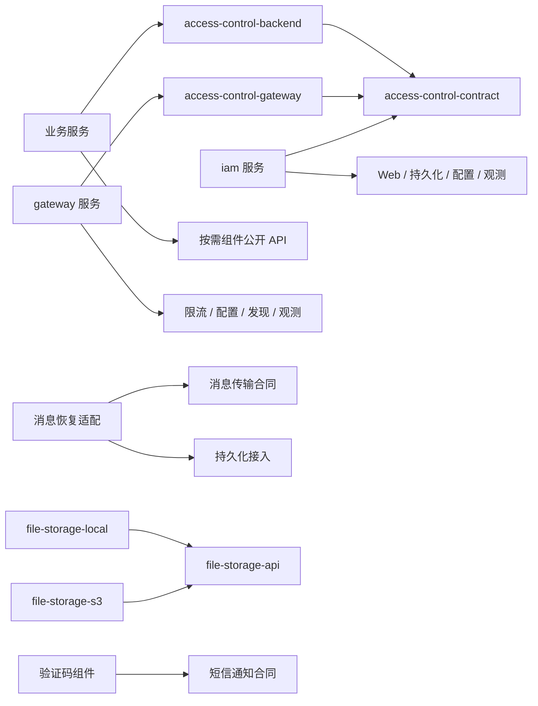

# 总体架构

## 状态与依据

总体方案、六阶段及 A01—A12 于 2026-10-19 获确认，来源与精确摘要见[研发路线](../product/02-研发路线.md#整体方案与阶段一确认)。本页维护批准结论，具体实现和授权以[当前任务](../work/04-结构规则.md#唯一任务记录)为准。阶段 1 已验收收尾；当前批准阶段 2a 本地结构规则、真实正反例与产品质量入口适配，工具位于 `harness/`，产品位于 `platform/`。图中其余尚未交付能力仍为目标布局，不创建空目录。现有 Web／BOM 的使用合同见[接口响应组件](03-接口响应组件.md)，构建基线见[工程基线](02-工程基线.md)。

## 仓库分区与管理边界

按交付物和使用入口分区：产品工程、部署资源、研发 Harness、文档各有一个根目录。目录回答“到哪里开发／使用”，Maven 模块回答“如何构建／发布”，Java 包回答“规则由谁负责”，Maven 工程目录与 artifactId 严格同名，Java 包按领域与职责命名。

```text
domain-forge/
├── AGENTS.md / README.md                 # 两个薄入口
├── dev                                  # 本地统一薄入口，转调 harness/cli.py
├── platform/                            # Domain Forge 企业研发底座
│   ├── pom.xml、.mvn/、mvnw、mvnw.cmd    # 内部 parent／聚合与构建入口
│   ├── domain-forge-bom/                              # domain-forge-bom，对外版本组合
│   ├── framework/                        # 可按需消费的技术组件，不承载业务领域
│   │   ├── domain-forge-web-support/
│   │   ├── persistence/                  # PostgreSQL／MyBatis-Plus／Flyway 接入
│   │   ├── cache/
│   │   ├── distributed-lock/
│   │   ├── rate-limit/
│   │   ├── idempotency/
│   │   ├── access-control/               # contract、backend、gateway
│   │   ├── file-storage/                 # api、local、s3
│   │   ├── messaging/                    # 传输及可选 Outbox 接入
│   │   ├── scheduling/
│   │   ├── notification/
│   │   ├── verification-code/
│   │   ├── configuration/
│   │   ├── service-discovery/
│   │   └── observability/
│   ├── services/                         # 独立运行的自研后端
│   │   ├── iam/                          # 身份与访问管理，含组织／角色／菜单
│   │   └── gateway/
│   ├── templates/ddd-service/            # DDD＋轻量 CQRS 独立微服务模板
│   ├── test-support/architecture-rules/  # 可发布的测试规则 JAR，仅 test scope
│   └── verification/                     # 脚手架自身验证工程，不发布运行库
│       ├── smoke/boot-smoke/              # 现有启动探针
│       ├── consumers/consumer-a、consumer-parent/consumer-b/
│       ├── contracts/                    # 消费契约快照及兼容性基线
│       ├── system/                       # 跨服务权限／消息／恢复等真实场景
│       └── performance/                  # 负载、数据准备及性能断言
├── deploy/                              # 项目级运行组合，不参与 Maven 聚合
│   ├── local/                            # 开发／联调依赖与启动配置
│   └── compose/                          # 生产参考、备份恢复、升级回退资源
├── harness/                             # AI 与人工研发共用的执行工具
│   ├── cli.py                            # 薄分派；现有控制面／产品入口解析与执行
│   ├── hooks/                            # pre-commit、pre-push，调用同一入口
│   ├── control_plane/                    # 上下文、任务与交付证据路由
│   ├── engineering_gate/                 # 源码／依赖／架构检查及自身测试
│   └── product_gate/                     # 调用真实产品场景及核对结果
├── docs/                                # 仅维护有效文档正文
│   ├── 00-文档导航.md
│   ├── product/                          # 产品与当前路线
│   ├── architecture/                     # 总体及现行能力设计
│   ├── standards/                        # 编码与工程规则
│   ├── workflow/                         # Harness 使用及研发流程
│   ├── guides/                           # 接入、运行、升级指南
│   └── work/                             # 当前任务与仍未解决的事项
└── .github/workflows/                    # 必要独立复核的可选执行供应方；替代验收前保留现行政策
```

图中未交付的能力是目标位置，不创建空模块。目录统一用稳定英文职责名，Markdown 正文按编号中文命名，不给目录再叠加一套阶段编号。`deploy/` 单列，是因为它组合服务和数据库等运行依赖，具有独立的操作入口；`harness/` 单列，是因为它执行研发流程，不属于业务运行时依赖。部署与 Harness 都是代码，照常接受适用检查。

| 位置 | 构建、交付和所有权 |
|---|---|
| `platform/framework`、`platform/domain-forge-bom` | 参与内部 reactor；发布普通 JAR／POM；组件的单元与集成测试放各模块 `src/test` |
| `platform/services` | 参与内部 reactor；交付可执行服务制品／镜像；业务库迁移随所属服务，不堆到根目录公共 SQL |
| `platform/templates` | 独立初始化资产，不作为 reactor 子服务；生成工程拥有自己的 Wrapper、parent 选择、依赖、配置和发布周期 |
| `platform/test-support` | 结构规则作为测试制品按固定版本消费，仅使用 test scope；不能进入产品运行依赖，不重复实现现有规则引擎 |
| `platform/verification` | 单独目标运行探针、组合与性能验证；消费工程不进入平台 reactor，不靠相对源码、隐含本地 install 或父 POM 获取平台实现 |
| `deploy` | Compose／脚本引用固定服务制品及运行依赖；只负责组合与操作，不复制业务数据库迁移，不保存实际密钥 |
| `harness` | 自身工具代码、工具测试及校准夹具；产品场景源码归 `platform/verification`，避免两处复制消费者；临时结果不成为规范 |
| `docs` | 产品、设计、规范、流程、指南及当前任务；机器可执行合同随其真正所有者维护 |

### 命名与构建边界

目标以 `platform/` 替换 `code/`：此目录交付 Domain Forge 企业研发底座，包含可复用库、可部署服务及生成资产。`backend/` 容易被理解成单个产品的后端，不能准确说明对外组件／模板；`ddd/` 把方法名当作产品边界，容易误导技术组件也必须建立领域模型。`platform/` 不表示要新增一个运行时平台服务。

二级目录直接表达使用方式：`framework` 引入 JAR，`services` 部署进程，`templates` 生成独立工程，`bom` 管依赖版本，`test-support` 引入测试规则，`verification` 运行平台自身验证。`framework` 是成熟技术的接入和稳定 API，不要求自研 ORM、事件总线或统一基类。独立验证工程与可分发测试库分开，是因为前者不应成为消费者依赖。

| 命名对象 | 当前或原建议 → 推荐 | 依据与限制 |
|---|---|---|
| 产品工程根目录 | `code/` → `platform/` | 表达企业研发底座；代码与文档仍在同仓库分区 |
| 组件目录 | `code/components/` → `platform/framework/` | 与可部署服务区别；不把组件目录当限界上下文 |
| 版本组合 | `platform/domain-forge-bom/` | 模块目录与公开 artifactId `domain-forge-bom` 严格一致 |
| 身份服务 | 原建议 `services/identity/` → `platform/services/iam/` | Identity and Access Management，覆盖身份、组织、权限与菜单，不只账号身份 |
| 网关服务 | `platform/services/gateway/` | 技术入口；不伪装成业务领域，不加无意义 DDD 分层 |
| 工程模板 | 原建议 `templates/business-service/` → `platform/templates/ddd-service/` | 明确生成 DDD＋轻量 CQRS 微服务；实际业务上下文由消费项目命名 |
| 模糊能力名 | `lock`／`file`／`access`／`discovery` → `distributed-lock`／`file-storage`／`access-control`／`service-discovery` | 说明能力边界；Web 已公开名称 `web-support` 保留 |
| 独立消费者 | `consumer-a`／`consumer-parent/consumer-b` | 目录与原 artifactId 一致；A 仍是无 parent 的 BOM-only 消费，B 仍继承自有 parent |

目录名、Maven 坐标、Java 包和服务注册名分别治理。公开 `domain-forge-bom`、`domain-forge-web-support` 及 `org.domainforge.web` 保持；内部根 artifactId 为 `platform`，探针为 `boot-smoke`。改路径不顺带修改公开 API／制品身份。新制品采用 `domain-forge-<能力或服务>`，仅有真实供应方隔离需要时加 `-api`／`-local`／`-s3` 等后缀；内部聚合使用 platform、framework、verification、smoke 等职责名，对外模块目录与完整 artifactId 同名。内部 parent 的 relativePath、聚合 modules 和调用路径需同步迁移。

### Maven 层级组织

2026-10-19 用户确认保留 `platform/`，模块目录名与 `artifactId` 严格一致。每个已经存在的 Maven 组织层级提供 `pom.xml`，仅列直接子模块；内部模块逐层继承直接父级，`relativePath` 为 `../pom.xml`。根统一管理 Boot BOM 与构建插件，中间聚合只管理本层模块，不注入依赖、属性覆盖或插件执行。

```text
platform/pom.xml                                  # platform
├── framework/pom.xml                             # framework
│   └── domain-forge-web-support/pom.xml
├── domain-forge-bom/pom.xml
└── verification/pom.xml                          # verification
    ├── smoke/pom.xml                             # smoke
    │   └── boot-smoke/pom.xml
    ├── consumers/pom.xml                         # 独立 reactor，只聚合 A/B
    │   ├── consumer-a/pom.xml                    # 无 parent
    │   └── consumer-parent/pom.xml               # B 自有 parent
    │       └── consumer-b/pom.xml
    └── contracts/                               # 合同资源，不参与 Maven 构建
```

`verification/pom.xml` 聚合 `smoke`；`consumers/pom.xml` 是独立构建根，不纳入平台 reactor，也不成为 A/B 的 parent。消费聚合提供本层统一入口；独立性仍由两项目分别在仓库外、独立缓存和显式制品仓库下构建证明，不能用聚合构建代替。A 无 parent、B 自有 parent 是保留的消费合同，不为了目录层级让它们继承平台。

现有 11 个 POM 对应 7 项平台 reactor 与 4 项独立消费 reactor。`src`、Java 包、`resources`、`target`、`.mvn` 和合同版本目录不是 Maven 组织层级，不放置空 POM。上方未实现能力只表示规划位置；成为 Maven 模块时目录按最终 artifactId 同名，不为计划提前创建模块。

DDD 语言体现在所属服务内，例如 IAM 的账号、成员、角色、授权等规则和用例，以及 `application/command`、`application/query`、`domain`、`infrastructure` 的明确责任。单上下文服务可直接使用 `org.domainforge.iam` 作为上下文根包，不再嵌套 `iam/iam`；消费工程使用自己的组织／项目／上下文包名。包名不替代聚合不变量、CQRS 权限、事务、事件和防腐边界验证。Harness 复用已有实现，路径迁移不演变成重写平台。

产品 reactor 管理 BOM、实际组件、服务及确需发布的测试规则；探针和组合验证由明确验证目标调用。没有通用 `shared-domain`，没有每个业务共用的 User／组织实体。示例领域仅存在于验证夹具，不进入模板生成的真实业务模型。版本化文档、模板、组件、服务与质量规则记录相容关系，不强迫它们拥有相同版本号或同步升级。

HTTP／集成事件的合同源随所属服务或公开合同制品维护；只选择一种权威来源并生成另一种表示。实际核查，现有两个消费者的 OpenAPI 快照及 manifest 已迁至 `platform/verification/contracts/web-support/0.1.0-r2.1` 作为兼容性基线，不归入 Harness。受支持版本的契约基线按兼容责任保留，不因“只维护当前文档”而删除。检查配置及记录格式留在所属 Harness 工具旁；不另建全局合同杂物目录。

**命名规则**：项目维护的 Markdown 使用 `两位序号-简体中文名称.md`，目录内唯一，按主题排序，数字不是版本或日期。新增主题使用未占用编号，避免全部重编号；名称不带 `v1`、`final` 或时间戳。只有两个约定薄入口保留英文文件名。代码目录、类名、机器合同和工具协议名称不受此 Markdown 命名规则影响。稳定文档 ID 与路径分离，迁移不因改名改变规则身份。

## 产品交付单元与依赖

### 能力清单及交付形态

当前已验收 Web 组件、平台 BOM、探针及两个消费者，精确对象见接口组件验收依据。下表为首版规划，其他能力尚未实现。目录名是能力族；一个能力族可以包含有真实隔离需要的多个制品。

能力范围依据当前[产品定义](../product/01-产品定义.md#首版通用能力清单)。此处维护组件设计；未定的实现仍需对应单元批准。

| 能力族 | 使用者及使用方式 | 必须交付的能力、边界与依赖 |
|---|---|---|
| `web-support` | HTTP 服务显式选用响应／异常处理及装配 | 统一响应与错误、必要内部诊断；不决定业务成功或访问授权；不依赖 IAM、数据库 |
| `persistence` | 服务基础设施引入持久化接入；应用声明实际事务 | MyBatis-Plus、PostgreSQL、Flyway，单库事务、迁移、多数据源；PO／Mapper／业务 SQL 归服务；不提供跨库原子性 |
| `cache` | 有缓存场景的适配器使用缓存合同 | 读写、失效、TTL 及失败语义；缓存不是业务事实权威；具体默认实现及组合待定 |
| `distributed-lock` | 确有跨实例互斥需求的用例选择锁合同 | 作用域、租约、释放、丢锁语义及资源保护前提；不依赖缓存业务 API，不声称任意场景自动严格互斥 |
| `rate-limit` | 网关／后端传入可信限流维度与配额 | 判定、拒绝、运行依赖失效行为；不持有账号模型，不依赖锁组件 |
| `idempotency` | 有重试风险的命令接入请求标识与结果合同 | 处理中／已完成／未知结果、并发重复及恢复；不把锁或短 TTL 当作幂等保证；请求幂等与消息消费去重分别验证 |
| `file-storage` | 应用使用 `file-storage-api`，运行时选择 `file-storage-local` 或 `file-storage-s3` | 上传、下载、删除、信息、安全访问；两个实现首版均交付；只依赖 API，互不依赖；业务关联及资源授权归业务服务 |
| `messaging` | 需要异步协作的服务选择传输；需要可靠发送则额外选择 Outbox | 发布、消费、业务保存后发送恢复；Outbox 依赖传输合同及本地持久化接入，必须加入业务同一事务资源；不依赖 IAM |
| `scheduling` | 服务实现任务处理合同，管理端使用所选框架能力 | 运行期改周期、暂停／恢复、手动触发及执行记录；不自建通用任务中心；重复执行及失败恢复责任须明确 |
| `notification` | 应用直接使用技术无关短信合同，配置服务商适配 | 首版真实短信发送、结果与失败映射；服务商待定；邮件仅保留扩展方向，不声称已支持 |
| `verification-code` | 需要验证码的用例使用生成／校验／消费合同 | 过期、尝试及发送限制、一次使用；发送依赖 notification；状态原子性独立设计；不依赖 IAM，也不自动决定注册策略 |
| `configuration` | 服务启动接入 Nacos，按明确范围接收动态变更 | Nacos 配置权威、启动与运行故障、实际生效；不建立平行权威来源，不要求同时启用服务发现 |
| `service-discovery` | 有动态寻址需要的服务／网关单独启用 | Nacos 注册、发现、实例变化；可共用受管理客户端版本，不强制依赖 configuration 的业务 API |
| `observability` | 服务装配日志、健康、指标、链路接入 | 上下文传播、脱敏、必要诊断及故障隔离；不依赖 IAM、不包含默认观测后台，不拥有安全审计模型 |
| `access-control` | IAM 引入 contract；业务后端选 backend；网关选 gateway 适配 | 技术无关的身份／授权交换合同、当前状态校验和入口执行；适配依赖合同及实际客户端；不引用 IAM 实现、不把网关身份校验当资源授权 |

IAM 是服务，不是一个可随意嵌入的“用户组件”；组织、角色、菜单、数据范围与安全审计属于其内部职责。网关也是服务；其他能力优先以库和既有中间件接入交付，不一项能力建一个微服务。除已确认技术外，不在总体方案中偷偷决定 Redis 缓存、消息中间件、任务框架或短信服务商及其版本。

### 制品拆分与装配

普通能力先一个普通 JAR，内部区分 `api`、`internal`、`autoconfigure`。**公开只表示允许外部消费，不表示允许所有职责层使用**；调用方与类型边界按下表声明。只有独立调用方、可替换供应方或必须隔离的运行依赖存在，才拆出 API／适配制品。当前文件双实现、access-control 两种运行栈、可选 Outbox 已有拆分理由；不要给每个能力统一生成 api/core/impl/starter 四个模块。

| 公开合同类别 | 允许调用位置 | 类型与隔离约束 |
|---|---|---|
| 技术无关能力 API，如文件操作、短信发送、身份事实合同 | 应用及需要它的基础设施；入口仅在自身协议职责需要时使用 | 参数、结果和错误不泄漏 HTTP／ORM／供应商 SDK；领域仍不依赖平台组件，不因技术无关就获得领域准入 |
| HTTP 协议接入，如 `ApiResponse`、`HttpFailureResponses` | HTTP 入口及承担 HTTP 协议适配的基础设施 | 可以包含 `ResponseEntity`、序列化／OpenAPI 元数据；不得进入应用合同或领域；不得反向依赖持久化实现 |
| 持久化、缓存客户端或传输等技术接入 | 相应基础设施适配器 | 可使用其必要技术类型；应用不得直调 Mapper／SDK，Controller 不得因“技术入口”直达数据库 |
| 公开配置／工厂及自动装配入口 | bootstrap；框架发现机制按明确配置加载 | 仅接线、配置和生命周期；不能借此访问其他组件 `internal` 或承载业务执行 |

现有 Web 合同含 HTTP 类型是合法协议边界，保留其 GAV、包名与 API，不机械包装或拆包。在既有模块／合同声明上明确公开类型及允许调用职责，沿实际源码与依赖身份核对；不按 `.api` 名字或整个组件 JAR 自动放行应用访问。未知归类须显式处理，公开合同的传递类型也受同类边界约束；技术无关合同不得通过参数、返回值、注解或父类型间接引入技术接入类型。已有 API 是否适用由调用位置决定，领域模型始终使用自己的业务语言。

```text
framework/file-storage/                         framework/access-control/
  api/       → domain-forge-file-storage-api       contract/ → domain-forge-access-control-contract
  local/     → domain-forge-file-storage-local     backend/  → domain-forge-access-control-backend
  s3/        → domain-forge-file-storage-s3        gateway/  → domain-forge-access-control-gateway
```

以上坐标为拟定名称，只有已有 Web/BOM 坐标是当前事实。目录聚合 POM 不代表发布新运行库。普通 JAR 不做 Boot 可执行重打包；服务需要时才启用 repackage。自动装配负责接线、默认适配及配置校验；组件加入 classpath 不应无条件连接所有中间件、扩大扫描范围或开启业务能力。默认本地文件只针对选择文件能力的应用；选择 S3 时不得悄悄退回本地。多个候选实现必须有明确选择，不靠 Bean 覆盖顺序。

### 三种消费方式

| 消费方式 | 使用步骤及责任 |
|---|---|
| 使用技术组件 | 导入固定平台 BOM → 显式添加所需 JAR → 配置并选择实现 → 调用公开合同 → 验证本项目成功／失败路径；直接使用到的 API 显式声明依赖 |
| 使用身份／网关服务 | 部署固定服务制品 → 配置本项目地址、调用身份和隔离资源 → 通过公开 HTTP／协议调用；不能把服务可执行 JAR 当库，也不能连接 IAM 私有表或会话键 |
| 初始化业务工程 | 固定模板版本，生成项目自己的工程 → 保留公司 parent 或选择自己的 parent → 通过 BOM 消费组件 → 配置项目 IAM 与运行资源；后续升级组件和模板变更分别评估，不能覆盖项目业务代码 |

现有 `domain-forge-bom:0.1.0-r2.1` 已在 R2-01 精确候选内验收，不表示生产风险已获豁免。BOM 的作用是管理版本，不会自动引入所有依赖，也不能替消费项目管理构建插件。当前 BOM 包含 Boot 依赖版本组合；若公司 parent 同时管理这些依赖，须核查有效 POM 与依赖树，显式处理冲突并验证组合，不靠 import 顺序猜测。[Maven 依赖管理说明](https://maven.apache.org/guides/introduction/introduction-to-dependency-mechanism.html)

```xml
<!-- 消费示意：这两个坐标对应当前候选；未展示的公司 parent／插件继续由项目管理。 -->
<dependencyManagement>
  <dependencies>
    <dependency>
      <groupId>org.domainforge</groupId>
      <artifactId>domain-forge-bom</artifactId>
      <version>0.1.0-r2.1</version>
      <type>pom</type>
      <scope>import</scope>
    </dependency>
  </dependencies>
</dependencyManagement>
<dependencies>
  <dependency>
    <groupId>org.domainforge</groupId>
    <artifactId>domain-forge-web-support</artifactId>
  </dependency>
</dependencies>
```

文件消费示例是应用依赖 `file-storage-api` 并装配一个所需实现；若 SDK 存在业务含义差异，业务基础设施再以本地语义适配。消息可靠发送示例是命令事务内保存业务数据及 Outbox，提交后发送器使用 messaging 传输合同；只依赖基础传输并调用 send 不具有同样保证。每个组件交付时在对应指南写明依赖片段、最小配置、成功调用、典型失败、扩展实现及升级限制，不只列“支持某能力”。

Maven scope 依据实际使用：源代码直接引用的公开 API 是编译依赖；完全由运行装配选择且源码未引用的独立适配可用 `runtime`；若 bootstrap 显式引用其装配类型，则在装配位置声明编译依赖。测试工具用 `test`；不把必须打包的运行依赖误设为 `provided`。组件必须的库可正常传递，真正可选实现用明确的可选声明／独立制品隔离；不能仅靠 `optional` 标签掩盖启动时必需的 SDK。

### 依赖方向与边界原则

下图表示编译依赖；BOM、远程调用和部署资源不混在图中。未声明的跨组件依赖需在对应能力设计中说明真实必要性，不能用 common 消除循环表象。



1. 组件不依赖服务、模板、消费项目或 Harness；服务之间使用公开运行合同，不依赖对方实现 JAR。无环依赖与运行时数据所有权都要成立。
2. 领域模型仅依赖自己的业务类型和必要 JDK 类型；通用技术能力由应用公开合同或基础设施使用。平台不提供所有领域都继承的 BaseEntity、BaseService、统一业务仓储或万能 User。
3. 应用可以直接使用已声明允许的技术无关能力 API；只有业务语言、失败语义或替换需求需要翻译时才增加本地出口。MyBatis、S3、Redis、出站 HTTP 客户端留在基础设施；HTTP 响应合同属于入口／协议适配，不能返回到应用合同。装配只使用允许的配置入口和本上下文实现，不扩大其他组件内部可见性。
4. 共享底层客户端不等于能力间互相依赖。例如 cache 与 distributed-lock 可以采用同一受管理客户端，但不能用 cache API 假装提供锁的正确性。业务一致性由能力合同和实际资源保护共同证明。
5. 平台 BOM 只登记实际可消费的受支持制品；内部 parent 管插件与内部构建，不作为外部必须继承的父工程。模板／CI／Harness 不成为运行时传递依赖。
6. 版本化公开合同避免暴露内部表、实体和异常。新增字段、状态和失败含义评估旧消费者；破坏性变化提供明确升级安排，并用两个独立消费者验证。不可用依赖不得被转换为业务成功。

## DDD 边界与代码映射

采用轻量 CQRS：命令与查询按职责、合同和模型分开，默认同库、同步方法调用。独立读库、异步投影、事件溯源、命令总线和通用分发框架都不是默认依赖；有真实需求时另行设计一致性和恢复。

### 上下文、模块与模型

IAM 首版仍是一个身份权限限界上下文和一个服务，其账号／会话、组织／成员、角色／授权、菜单声明及审计是内部职责，不因包名就拆成多个上下文。业务客户、员工等模型属于消费项目；与身份关联时使用稳定标识，不共用可变 User 实体。网关是技术入口，组件是技术能力，都不天然等同于领域上下文。

默认一个服务一个 Maven 模块，以包约束上下文边界；只有独立发布、独立消费或必要技术隔离时拆模块。单上下文服务直接以服务根包为 context，下面明确采用扁平布局；不再额外嵌套 `<context>` 或 `iam/iam`。内容随真实用例创建，IAM 聚合及生命周期须在具体设计中确定。

```text
platform/services/iam/
├── pom.xml
├── src/main/java/org/domainforge/iam/      # 唯一 context 根包
│   ├── bootstrap/                          # 启动、配置与适配器接线
│   ├── interfaces/
│   │   ├── http/                           # Controller、协议请求／响应转换
│   │   ├── message/                        # 入站消息与反序列化
│   │   └── job/                            # 任务触发适配
│   ├── application/
│   │   ├── command/<usecase>/              # Command、Handler、结果；不强制接口对
│   │   ├── query/                          # Queries、Filter、View；必要编排用例
│   │   ├── event/                          # 内部事件处理、对外事件转换及协调
│   │   ├── port/                           # 本上下文需要的外部业务能力接口
│   │   └── contract/event/                 # 需要公开的集成事件数据合同
│   ├── domain/
│   │   ├── model/<aggregate>/              # 聚合根、实体、值对象、状态转换
│   │   ├── policy/                         # 可独立表达的纯业务规则
│   │   ├── service/                        # 无法归属单实体的领域行为
│   │   ├── repository/                     # 聚合仓储接口
│   │   └── event/                          # 本上下文内部的不可变领域事实
│   └── infrastructure/
│       ├── persistence/                    # 仓储实现、PO、Mapper、模型映射
│       ├── query/                          # 查询合同实现、SQL 投影
│       ├── acl/<external-system>/          # 防腐适配、外部协议与错误翻译
│       └── messaging/                      # 序列化、传输、Outbox 接线
├── src/main/resources/
│   ├── db/migration/                       # 本服务拥有的版本化迁移
│   └── contracts/                          # 所需协议源；与 Java 表示只选一种权威源
└── src/test/                               # 模型、用例、适配及运行契约测试
```

**装配归属决定**：在现有 context 职责中增加明确的 `bootstrap`，它属于本 context，不再同时登记嵌套 assembly；保持模块根包唯一、互不重叠。bootstrap 可依赖本上下文四类实现及公开装配入口，四类职责均不得反向依赖 bootstrap。bootstrap 只负责启动、配置、接线与生命周期，不承载业务判断、命令／查询执行或 SQL。结构检查证明依赖方向，职责语义由真实场景及评审证明，不能声称包分类能自动识别全部业务逻辑。

阶段 2a 规则已增加 bootstrap 归属与反向依赖检查，使用路径和证据边界见[职责校准](../workflow/04-工程检查设计.md#默认职责与技术注解校准)；本地适用验证状态以当前任务为准，不能将整个 IAM 声明为 assembly 绕过检查。服务职责声明绑定已批准的模块合同；改变 context／assembly 身份属于架构语义变化，需复审并使既有结果失效，不能仅凭目录名字自动判定业务所有权。合法查询实现、应用允许的事务元数据及组件 API 分类同步核验。可发布规则 JAR 可以在阶段 4 提取，本仓库实际约束不能延后。

启动类放 bootstrap 时须显式覆盖本服务根包的组件发现范围并验证真实启动，不能只依赖默认扫描或扫描全部 `org.domainforge`。将来确有多个上下文同部署时，各 context 使用互不嵌套的兄弟根包，独立 assembly 位于这些根包之外；这不是当前 IAM 默认布局。网关和纯技术探针仍按真实装配模块管理，不伪造领域上下文。

只在已有内容多到需要分组时增加 `<usecase>`、`<aggregate>` 等子包。领域模型不依赖 HTTP、Spring、ORM、平台客户端、序列化或消息框架。应用允许必要装配／事务注解；不为移除注解再生成事务包装层。消息入口负责技术接收，应用负责业务消费语义与去重事务，不能只在 Listener 内捕获异常并确认成功。

| 对象 | 必须承担的责任 | 不应承担的责任 |
|---|---|---|
| 聚合根 | 维护本次一致性边界内的不变量，提供业务行为；引用其他聚合时优先用 ID | 按数据库表机械生成；暴露任意字段 setter；调用远程 SDK／发 MQ |
| 值对象／实体 | 身份、值相等性、合法状态及真正业务规则 | 继承框架 PO、承载 HTTP 或数据库生命周期 |
| 领域策略／服务 | 真实业务判断；应用准备外部事实后传入，以确定输入验证 | 将全部业务移到一个万能 DomainService；隐藏网络调用 |
| 应用 Handler | 授权、业务编排、调用规则所有者、事务与失败结果 | 自己重复聚合规则；直接调用 Mapper／SDK；只转发且毫无职责 |
| Repository | 按聚合需要加载、保存，明确不存在／并发冲突等语义 | 充当报表查询、通用 CRUD 超集或返回 PO／IPage |
| Query 合同 | 按用例表达筛选和展示数据，技术无关 | 暴露 SQL、Wrapper、ORM 分页对象或绕过权限 |
| 防腐适配 | 翻译外部模型、协议、状态和失败语义 | 取代本地业务决策；把外部错误直接当作本地成功 |

编译依赖为：入口 → 应用公开方法／查询合同；应用 → 本领域、自己的出口及允许的组件 API；基础设施 → 所实现的应用／领域接口及技术库；bootstrap → 所需实现。基础设施实现查询合同是依赖反转，不是 Controller 直接依赖 SQL。跨上下文只能引用明确公开的用例／协议，不能引用对方 Repository、领域实体或内部查询实现。

### 命令路径

`HTTP／消息入口 → CommandHandler → 聚合／领域行为 → Repository 合同 → 持久化实现`

Command 表达业务意图，Handler 负责授权、编排及事务边界，聚合维护业务不变量，基础设施保存状态并处理技术转换。需要业务事件时才定义事件；不为单个方法生成接口／实现对、总线或通用基类。简单维护若没有复杂不变量，允许轻量应用用例，不伪造聚合；一旦存在状态约束、并发或业务决策，就须有明确所有者和验证，不能当普通字段更新绕过。

客户端只提供命令输入，不直接提交可保存的聚合／PO。输入格式由入口校验，业务合法性由模型／用例判断；两者不能互相代替。持久化适配负责聚合与 PO 的往返映射；模型和 PO 分开，不因同字段而合并。唯一约束、条件更新或乐观版本处理与业务并发规则配合，不能只靠先查后写防止竞争。

### 纯查询最短路径

`Controller → Query 合同的读取实现 → SQL／Mapper → ReadDTO`

示例：`AccountQueries.list(filter)` 是应用侧技术无关查询合同；`SqlAccountQueries` 在基础设施实现并直接投影 `AccountView`。Controller 依赖查询合同，不依赖 MyBatis；接口是边界，不是额外执行层。没有编排时，不再包一层只转发的 QueryHandler、QueryService、领域仓储或聚合；有真实转换需求才额外创建对象，不强制 PO→Entity→BO→DTO 多次复制。

| 查询类别 | 允许路径／必须保留的责任 |
|---|---|
| 本上下文列表、详情、筛选、统计等纯展示 | 读取实现可直接使用本上下文 SQL／Mapper 并返回最终展示结果；可以联查本上下文拥有的表，不加载领域模型 |
| 有权限及数据范围要求 | 在查询用例边界执行授权，SQL 使用可信的服务端范围约束；外部请求不能自行提供可信授权范围。默认拒绝及范围过滤必须真实验证，不能以缩短调用链为由略过 |
| 需要跨源编排、资源授权决策或业务判断 | 增加确有职责的查询 Handler／应用用例；需要领域规则时调用规则所有者，不把决策偷偷塞进基础设施 |
| 需要其他上下文数据 | 使用公开查询合同或合法投影；不能通过同库联表读取其他上下文私有数据 |

查询不得修改业务状态；必要安全审计与观测按各自合同处理。分页、排序白名单、参数化查询、字段可见性、范围过滤和依赖故障仍需验证。查询权限的实际框架绑定须在实现中核查，不能假设接口注解或 HTTP 入口检查自然覆盖全部调用方。写操作必须重新校验当前条件，不能把之前查询成功当作写入授权或业务条件永久有效。

采用此短路径需要把具体公开查询合同及基础设施实现关系纳入源码／架构规则，防止合法短路径被误报，也防止借 query 包名绕过技术隔离或业务写入要求。

纯查询授权若可由统一用例拦截器承担，须验证 HTTP、内部调用等实际入口都生效；若需要加载资源后进行策略判断，则使用有职责的查询用例，不能为追求三段路径把授权塞入 SQL 适配器。数据库只读设置或 `readOnly` 元数据都不能替代无业务写入断言。首版默认查权威存储；若后续引入只读副本／异步投影，先确定延迟、读己之写及过期结果的用户合同。

查询性能从筛选、分页、索引和执行计划开始验证；批量查询消除 N+1，并约束最大结果量。简单查询不经过聚合重建；复杂统计允许直接 SQL，但仍只访问本上下文拥有的数据。

### 领域事件与集成事件

| 类别 | 所有者与用途 | 事务／可靠性责任 |
|---|---|---|
| 领域事件 | `domain/event` 表达本上下文业务变化；由聚合返回或暂存，应用处理 | 产生时可能尚未提交；事务内处理可随主事务回滚，不能提前宣称对外已生效 |
| 集成事件 | `application/contract/event` 表达愿意向其他上下文承诺的已提交事实 | 应用选择必要字段并映射；需可靠发布时与业务同事务写入 Outbox；传输实现归基础设施 |
| 任务／消息命令 | 要求接收方执行动作，具有明确处理者与结果合同 | 接收成功不等于业务完成；同样需要重复、部分完成及恢复设计 |
| 安全审计／普通观测 | 安全行为记录／技术诊断，各自有独立责任 | 不能用普通日志替代审计，也不能因订阅一个领域事件就声称可靠审计已完成 |

事件使用过去式业务名称和不可变数据，不携带聚合对象、凭证或全部表字段。集成事件最小信封包含稳定事件 ID、事件类型与合同版本、来源和发生时间；按实际需要增加聚合 ID／版本及关联 ID。合同版本不是聚合版本；重发同一事件不生成新 ID。发布方拥有公开含义，接收方通过自己的翻译适配使用，不共享发布方内部领域事件类。[领域事件与集成事件的区别](https://learn.microsoft.com/en-us/dotnet/architecture/microservices/microservice-ddd-cqrs-patterns/domain-events-design-implementation)

只有真实订阅者或业务副作用才引入事件；单一、明确的同步步骤可直接调用应用方法。事务内订阅不得暗含跨服务写入或不可回滚发送，也不能依赖未声明的监听器顺序维持不变量。无需建立强制所有实体继承的事件基类或统一命令总线。

**可靠发布推荐采用本地事务 Outbox，具体表、发送器与中间件组合在消息单元设计固定：**

```text
命令用例
  └─ 同一个本地数据库事务
       ├─ 读取并改变聚合，保存业务状态
       ├─ 处理必须同事务完成的内部领域反应
       └─ 映射需要公开的事件，写入 Outbox
     提交成功 → 返回本地已完成结果

发送器读取已提交 Outbox → 发布消息 → 记录发送结果
消费者接收 → 本地去重记录＋业务变更同事务提交 → 确认接收
```

Outbox 写入失败使包含该必需消息的业务事务回滚；事务回滚不能留下可发送事件。提交后进程中断由发送器恢复；发布成功但记录发送结果前中断会重复发送，因此按至少一次设计，不能承诺全链路 exactly-once。消费去重记录与业务效果只有加入同一实际事务才能防止本地重复；短信等外部副作用仍需服务商幂等键、状态查询或独立恢复方案。[Transactional Outbox](https://microservices.io/patterns/data/transactional-outbox.html)

可靠性边界还须固定：发送抢占／租约与多实例竞争、有限重试及退避、毒消息隔离和人工重放、积压告警、已完成记录清理、去重保留期。不清理仍待发送的必要记录。若用例要求顺序，按聚合／业务键明确排序和版本处理，不能假定所有消息全局有序。

`@TransactionalEventListener(AFTER_COMMIT)` 可用于提交后的本地通知或唤醒发送器，但单独使用不提供持久恢复；进程可以在提交后、监听执行前退出。必需发送事实已在事务中保存，唤醒丢失仍能扫描恢复。监听绑定的阶段和无事务调用也必须验证。[Spring 事务事件说明](https://docs.spring.io/spring-framework/reference/data-access/transaction/event.html)

### 事务边界与一致性

事务由应用用例决定，数据访问实现加入实际资源。默认围绕一个聚合维持本地不变量；不是强制“一事务只能写一张表／一个对象”。确有原子要求且同一实际本地事务资源可参与时，可由公开合同协调多个聚合或上下文，保留已有授权原则，说明锁范围、所有权和拆分代价。

| 情形 | 方案原则与必须证明的结果 |
|---|---|
| 单库写入 | 明确事务管理器、连接／数据源、异常回滚策略；事务真实入口上验证成功与中途失败回滚，不以注解存在代替 |
| 并发更新 | 由业务语义决定条件更新、乐观版本、唯一约束或锁；冲突明确返回或进行有界安全重试，不能覆盖别人结果 |
| 同进程跨上下文 | 只能经公开合同；若参与同一事务须实际证明，不能只凭数据库地址相同推断；频繁强耦合时重新评估上下文划分 |
| 多数据源／跨服务 | 默认无全局事务；每步本地提交，明确中间状态、成功时点、重复、补偿／人工恢复；不默认引入 XA、Saga 框架或分布式事务平台 |
| 网络、文件、短信 | 不属于数据库回滚范围；尽量不在持锁事务里等待远程调用；需要先后保证时使用明确状态机与恢复，不把同步调用包装成原子性 |
| 长流程 | 只有跨步骤确有持久进度和恢复需求才建立应用流程协调器；保存必要状态和重试键，不把普通多行方法升级成工作流引擎 |

Spring 事务代理、自调用、异常吞掉、线程切换与数据源切换都可能使预期边界失效；以实际调用路径验证。确定重试安全后才重试整个命令，并重新加载状态；不要重放已经发生但不可幂等的外部副作用。[Spring 事务声明说明](https://docs.spring.io/spring-framework/reference/data-access/transaction/declarative/annotations.html)

IAM 的禁用、撤权、改密及旧会话失效沿用已确认生效条件，不能因采用集成事件就改为“后台最终失效也算成功”。SQL 与会话状态的协调必须在 IAM 设计中固定权威判断、部分失败、恢复和成功时点；Outbox 本身不解决两个存储的即时原子性。授权检查的时点与操作期间并发变化也须明确，不能承诺不存在的全程锁定。

**审计例外单独保留**：已确认关键安全管理变更不因单独审计保存失败而阻断。不能把此类审计强行绑定到会使主事务回滚的必需 Outbox 写入；其隔离、缺口告警和补录按审计合同设计。身份生效条件失败不属于审计例外；普通观测故障也不改变业务成功定义。

### 防腐接口与适配

防腐层用于隔离外部语义；默认是消费方上下文内的适配器，不新增独立防腐微服务。接口归需要能力的一方，采用本地业务语言，返回本地事实和失败结果；外部 DTO、SDK、状态码和认证细节留在实现中。[防腐层模式](https://learn.microsoft.com/en-us/azure/architecture/patterns/anti-corruption-layer)

```text
应用用例 → application/port/<业务所需能力>
                         ↑ 实现
              infrastructure/acl/<外部系统>
                   ├─ 协议／客户端连接
                   ├─ 外部数据 → 本地事实
                   └─ 超时／不存在／拒绝／未知结果的翻译
                         ↓
                   外部公开合同
```

例如消费项目需要“当前操作者可管理的组织范围”，本地用例使用自己的范围事实，IAM access 适配返回的授权事实不直接变成本地域的 Account／Role。若通用短信或文件 API 已完全满足调用目的，直接使用其公开技术无关接口，不额外建立没有翻译职责的 SmsPort＋SmsAdapter。

| 协作类型 | 具体落位与约束 |
|---|---|
| 远程读取／命令 | 出口位于 application/port，HTTP／SDK 实现在 infrastructure/acl；设置总调用预算、超时和必要重试；结果未知不能当不存在或成功 |
| 同进程其他上下文 | 适配器调用对方已公布用例／查询合同；不进入其私有表、Repository 或内部包；没有语义差异时可直接使用明确公开合同 |
| 入站集成事件 | interfaces/message 解码公开合同，转换成本地命令／事实，交给应用用例；原始来源不自动获得本地业务权限，拒绝和毒消息有处理结果 |
| 外部错误与枚举 | 已知业务拒绝映射为本地明确结果；未知状态拒绝或进入待处理，不静默映射到成功默认值；技术细节留在脱敏诊断 |

防腐适配不拥有领域规则，不借适配绕过事务边界；缓存、批量请求或降级必须符合事实的新鲜度及失败合同。IAM 当前授权失败时拒绝的既有边界不能被“可用性降级”改写。

### 结构必须通过真实例子证明

模板完整交付至少有命令、纯查询、需要编排的查询三条经过验证的路径；领域行为、事务回滚、聚合往返、并发冲突和外部失败有实际断言。阶段 2 的最小模板仅证明独立构建／启动及结构约束，代表性模型使用验证夹具，不生成虚构业务；阶段 3 用真实 IAM 切片补齐产品证据，阶段 4 才验收完整可分发模板与质量工具。需要消息恢复的交付单元再加入事务后进程退出、重复投递和消费中断例，不为最初启动模板强装消息中间件。

架构检查只约束可判定边界：领域引 SDK、应用引 Mapper、引用其他上下文私有类型、合同泄漏 PO、组件依赖服务等必须失败；合法 bootstrap、Query 实现、应用事务元数据和直接复用已声明的技术无关能力 API 应通过；领域／应用依赖 bootstrap、应用使用 HTTP 合同以及跨组件 internal 调用应失败。业务语义仍由用例和评审负责，不能以目录齐全证明 DDD 正确。

技术参考仅支持 CQRS 的一般机制：[Microsoft CQRS](https://learn.microsoft.com/en-us/azure/architecture/patterns/cqrs)说明可共享数据存储及额外复杂度；[查询设计](https://learn.microsoft.com/en-us/dotnet/architecture/microservices/microservice-ddd-cqrs-patterns/cqrs-microservice-reads)说明读侧可独立投影。上述 Java 包结构、授权责任和短路径选择为已批准的本项目目标设计，不照搬其技术栈。

## 身份权限部署与调用方案

推荐每个项目拥有并运行自己的身份权限服务；同项目多个业务服务共享本项目 IAM 的公开服务。这里的“每项目一套”表示数据和发布责任，不预定只能运行一个进程，也不新增高可用承诺。平台交付后端管理与接入合同，管理页面仍由项目实现，不新增管理前端。

| 方案 | 收益、代价与判断 |
|---|---|
| 每项目独立 IAM 服务，推荐 | 登录、管理、会话及授权状态有统一所有者，业务项目可独立升级；增加一个服务和授权调用成本，受保护操作依赖该服务可用性 |
| 每个业务服务嵌入整套 IAM | 单应用启动较少进程，但多业务服务时容易形成多套写入入口、状态与升级责任；首版不同时维护此形态。若将来确有单体嵌入需求，单独设计验证 |
| 多项目共用一个统一账号／认证中心 | 会引入跨项目身份、隔离与集中发布的新合同，不符合当前项目独立责任及非 OAuth 中心边界，本轮不推荐 |

推荐拓扑为同一项目内 `gateway → business-service`，网关和业务后端分别通过身份接入查询 `iam`。IAM 独占账号权限库和会话状态的写入入口；业务后端不得直接读 IAM 表或依赖 Redis 内部键结构。每项目使用独立逻辑数据库及凭据；生产参考默认独立会话 Redis 实例，项目内其他能力不复用 IAM 状态凭据。共享物理数据库服务器可以按独立数据库与权限隔离设计；跨项目共享 Redis 实例不是默认受支持方案，不能只凭 key 前缀宣称隔离。

身份状态仍复用已确认的 Sa-Token 与 Redis，HTTP 仍只使用已确认的 Bearer Header；不变更为 JWT、OAuth 或跨项目单点登录。首版推荐业务后端按每次新授权取得 IAM 当前有效依据，不缓存跨请求的“允许”结果；IAM 自身执行本地身份用例，不经客户端反向调用自己。网关检查不能取代后端检查；传入的身份 Header 不作为可信主体，内部身份查询还须认证调用服务并限定项目范围。具体服务认证机制、超时和连接预算在 IAM 接入详细设计固定。

IAM 负责账号状态、会话有效性、角色／操作权限和授权范围；业务用例负责自身资源归属及数据过滤，并由本上下文把范围含义映射到自身模型和查询，不能承诺通用 SQL 改写自动覆盖任意业务。两者组合才形成最终业务授权，禁止把 IAM 返回“已登录”或一次网关放行解释为完整访问权限。原生声明解析和默认拒绝继续使用既定规则，不能把远端调用改造成未经验证的自定义注解框架。

选择在线校验的代价必须接受：IAM 或其必要存储不可用时，相关受保护操作拒绝或报告依赖不可用，不沿用旧允许状态；按合同匿名且不依赖 IAM 的操作不应因此整体失效。此选择有额外延迟和负载，首个 IAM 单元须实测；未来优化也必须保持撤权和改密的生效合同，不能以 TTL 放宽要求。

禁用、撤权、缩小范围或改密的“成功”仍按既定生效条件判断。在线 RPC 本身不证明 SQL 与 Redis 原子更新，也不保证多实例读到当前状态；详细设计须覆盖并发读写、部分失败、未知结果、恢复及重试。审计保存故障继续执行既定容错责任，不被混同为允许忽略授权状态失败。

在实现完整 IAM 前，先用最小真实集成验证 Sa-Token 原生令牌读取、声明执行与远端当前状态合同能正确协作，并验证跨实例撤销、直连后端、跨项目令牌、状态存储故障和敏感输出。若既定框架无法满足该组合，明确回报架构问题；不静默改为共享表、长期权限缓存或复制会话实现。该验证属于设计确认后的 IAM 单元，不在本轮执行。

## 模板与版本消费方案

模板生成独立工程，默认一个限界上下文；业务模型由消费项目负责，不生成虚构聚合。BOM-only 与公司自有 parent 均需验证。组件、模板、服务与质量规则分别记录兼容关系；不要求继承平台内部 parent。阶段 2 验证最小模板独立构建／启动，阶段 4 交付可分发质量工具及两个独立生成项目。

## 分别检查与关联验证

文档、真实产品和 Harness 分别维护检查入口；共同规范、合同和工具变化按现有策略执行关联验证。自动边界检查不能证明领域语义、授权或产品完成。候选仍需受控独立干净执行，GitHub 是当前有效供应方；本地脚本不自动替代独立证据。Q0—Q4 的成本测量、去重、影响选择、并发和供应方切换按[研发路线](../product/02-研发路线.md#检查优化边界)另行授权。1b-T 仅同步 142 行／146 处工具路径，不改变作业、检查、缓存策略、预算和信任政策；新 dev／cli 归入完整相关检查责任。

## 研发顺序与当前迁移

唯一顺序与退出要求见[六阶段研发顺序](../product/02-研发路线.md#六阶段研发顺序)；阶段 1 已验收收尾，当前仅实施已批准的 2a 结构规则及真实正反例。后续业务及 CI 优化未获授权，不创建尚未交付的空目录。

## 推荐决定与待确认事项

整体结构与依赖、DDD＋CQRS、事件／事务／防腐原则已批准。注册与初始权限、IAM 聚合及跨存储生效、服务间认证、尚未固定的默认实现／版本、可靠消息参数与性能负载阈值，须在对应单元实现前设计确认。无待定项自动转为默认选择。

## 结构验收条件

按[已批准 A01—A12](../product/02-研发路线.md#整体验收标准)逐单元验收；bootstrap、查询短路径及公开 API 分类由阶段 2a 真实规则正反例验证；静态可判定范围与运行语义分别记录，不将本地检查升级为服务产品或人工验收。

## 资料核对与结论范围

本页保留已批准方案的一手资料链接用于解释机制，来源不代替本项目运行证据。目标结构不是已完成能力清单；实现以实际制品、场景和精确验收对象为准。
