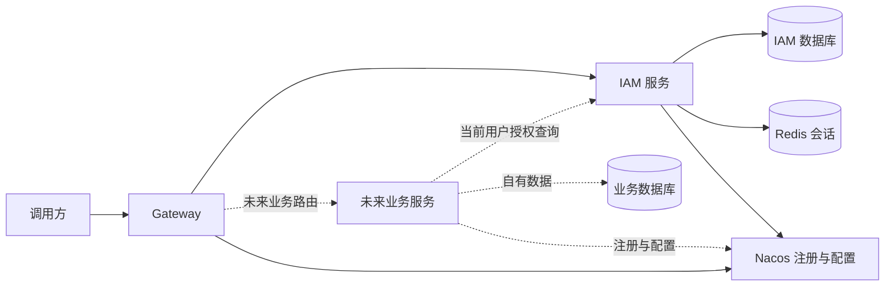
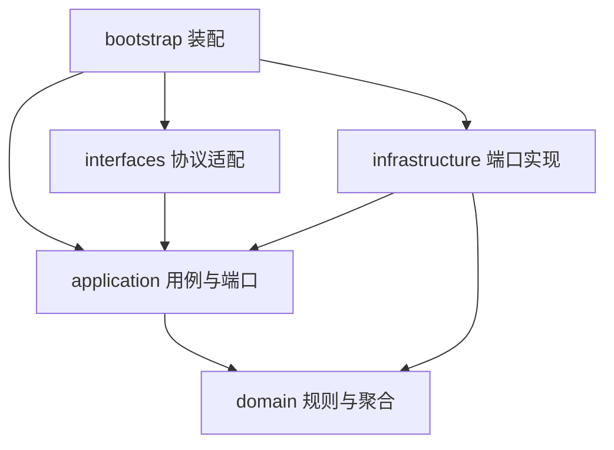

# 总体架构与 DDD 约束

状态：待讨论设计。依据：C01–C05、C12。主要决定见 ADR-0001、ADR-0002、ADR-0003；所有图描述候选设计，不代表已部署系统。

## 从领域到部署

脚手架本身的重点投入是可复用工程约束与升级体验。IAM 是后续产品的支撑域；会话框架、SQL 访问和服务治理属于通用技术能力，优先整合现有组件。

| 子域/能力 | 模型边界及所有者 | 候选部署单元 | 边界理由 |
|---|---|---|---|
| 身份、组织与访问授权 | IAM 上下文，用户担任规则负责人 | 一个 IAM 服务，独立发布 | 用户状态、角色绑定与组织范围共同决定访问资格，首批无拆分压力证据 |
| 入口路由与治理 | 平台技术能力，无独立业务模型 | Gateway，独立发布 | 入口协议与路由变化不应进入 IAM 领域模型 |
| 未来业务 | 各业务项目自己的限界上下文 | 各自的服务 | 拥有业务数据和对象归属，消费 IAM 的身份与授权语言 |
| 注册、配置、会话、持久化 | 外部基础设施 | Nacos、Redis、MySQL | 技术产品不等同于业务限界上下文 |

边界检查：统一 IAM 具备共同目标、语言、规则所有者和数据所有权；拆分收益尚无证据。Gateway 没有独立业务不变量，不为凑微服务数量创建领域层。IAM 输出身份与授权事实，业务上下文负责将数据范围映射到自己的资源，不把 IAM 的部门模型复制为业务组织模型。

## 系统上下文与数据权属

虚线为未来消费方或验收夹具，不是首批新增业务产品。注册配置连接与业务调用分开授权。共享数据库实例可以是开发环境节省资源的做法，但每个服务使用独立数据库/账号；不共享表、Mapper、跨库 JOIN 或数据库写权限。

IAM → 业务服务采用上游发布语言和稳定服务接口的关系：IAM 维护授权协议兼容性，消费服务的适配器把协议转换为自己的 `Actor` 和资源约束。IAM 不反向调用业务数据库，也不提供全公司统一业务实体。

## 服务内部结构

推荐单服务先按包分层，以 ArchUnit 形成可执行依赖约束；候选与 Maven 多模块方案对比见 [ADR-0003](../adr/0003-ddd-isolation.md)。

箭头表示编译依赖，不是调用时序。应用层定义外部能力端口，领域层定义有聚合语义的仓储边界；基础设施实现它们。领域层不依赖 Spring、Sa-Token、MyBatis、HTTP 或消息客户端。应用用例可使用事务机制，但事务边界不得泄漏到公共 API。

| 变更类型 | 归属 | 不应修改 |
|---|---|---|
| 角色能授予哪些数据范围 | IAM 领域规则和对应应用命令 | 网关路由或 ORM 通用基类 |
| 用户登录协议、输入校验 | interfaces + 应用用例 | 领域对象的持久化注解 |
| MyBatis 映射、SQL 或 Redis 序列化 | infrastructure | 对外 DTO 或业务服务领域模型 |
| 添加 S3 适配 | 使用方外部能力端口及基础设施实现 | 没有文件场景的业务聚合 |
| 注册发现、追踪、配置装配 | 技术组件和 bootstrap | 账号授权规则 |

## 公共组件提取标准

存在明确消费方、稳定约定和重复接入成本时才抽取 starter。首批候选能力组为 Web 协议、持久化/数据权限、缓存、授权消费；具体 Maven artifact 数量在 R2 收口，不要求一项依赖包装一个 starter。

授权契约保持小而稳定，业务资源规则留在消费方。禁止共享 IAM 聚合、持久化对象或可变用户对象；不预建全能 BaseService、全局 BaseEntity、通用事件总线和任意查询语言。

## 请求、事务和运维边界

- 首批跨服务同步调用采用明确超时、错误分类和有限重试策略；写请求不自动重试。具体 HTTP 客户端见 ADR-0005。
- 授权主链与失败时序见[安全模型](03-iam-domain-security.md)，网关放行不等于下游授权完成。
- 一个命令的数据库事务属于一个服务；不跨服务开启本地事务或默认使用分布式事务。
- 本地研发运行拓扑推荐 Compose，生产部署单独设计；本轮不生成运行文件。
- 日志包含服务名、请求关联标识和结果，不记录口令、Token、完整授权响应；健康检查区分进程存活与依赖就绪，管理端点不通过公开路由直接暴露。
- Nacos 提供外部化配置，启动所需连接参数由运行环境提供；身份、数据库等秘密不进入 Git。动态配置变更应有校验与审计，不允许把任意请求参数变为数据权限或路由绕过开关。

## 关键依赖与风险

统一 IAM 容易形成授权链的可用性依赖，这是推荐方案的已知成本。首批优先把正确性与失败行为说清楚；只有实测表明请求成本不可接受，才进入权限缓存或令牌内嵌权限方案的重评。不得把待解决的性能问题包装成无证据的高可用保证。
