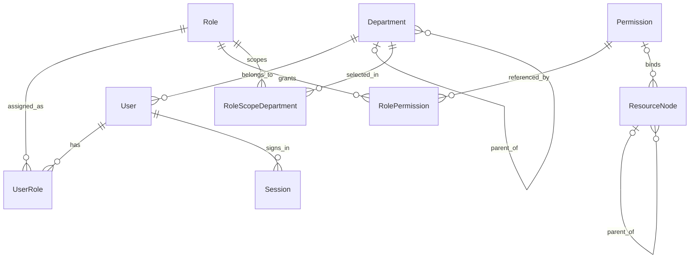
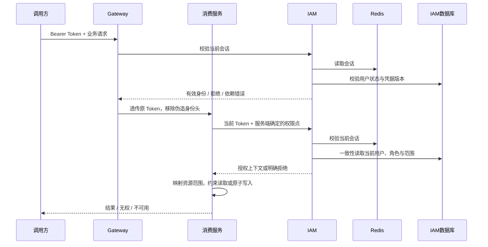

# IAM 领域模型与安全设计

状态：reviewing / 待讨论设计。日期：2026-09-19。业务与架构负责人：用户（两类职责均未确认本文）；建模整理：AI。

目的：为 C05–C10 建立可解释、可验证的身份与授权模型。本文是 IAM 唯一规范模型草案；来源为[需求基线](00-baseline.md)和下列场景。没有既有代码或数据可作为实现证据。示例主体、部门及记录均为设计夹具，不是真实业务数据。

## 1. 上下文与统一语言

候选只有一个 IAM 上下文，理由与外部上下文地图见[总体架构](02-architecture.md)。身份、组织和授权是其中的规则分组，不直接推导成三个微服务。未来业务服务拥有资源及对象级业务规则；IAM 只解释身份、权限点和组织范围。

| 术语 | 上下文 | 规范含义 | 不表示什么 | 别名 | 正反例 | 来源 |
|---|---|---|---|---|---|---|
| 用户 | IAM | 可登录的稳定账号身份 | 客户、员工档案或可共享的全局用户实体 | User | 改名后 ID 不变；不能用用户名当跨服务主键 | C06 |
| 部门 | IAM | 用户唯一所属的树形授权组织节点 | 多租户或业务组织万能模型 | Department | 用户属部门 A；不能同时属 A/B | C07 |
| 角色 | IAM | 有效权限点集合及一项数据范围策略的授权集合 | 职位或数据权限本身 | Role | 有角色但无当前权限点仍不能访问 | C07–C09；范围粒度为候选 |
| 权限点 | IAM | 服务端稳定的操作标识 | URL、菜单或客户端布尔值 | Permission | `iam:user:read`；菜单可见不等于接口有权 | C06；命名为候选 |
| 数据范围 | IAM/发布语言 | 对当前操作可访问资源的范围描述 | SQL 片段或任意过滤表达式 | DataScope | 部门集合或本人；空集合不是全部 | C08–C09 |
| 资源归属 | 业务上下文 | 业务资源对应的所属部门和本人字段语义 | 创建者必然等于所有者 | Ownership | 用户记录的本人是 userId；附件可由其业务定义 ownerId | C09；映射为候选 |
| 菜单/按钮 | IAM | 客户端导航和操作展示元数据，可绑定权限点 | 服务端授权依据 | ResourceNode | 隐藏按钮不代表撤销权限 | C06、C11 |
| 会话 | IAM | Token 对应的登录状态与过期、撤销信息 | 永久权限快照 | Session | 角色改变后会话可仍有效但权限变小 | C05；生命周期为候选 |
| 超级管理员 | IAM | 管理 IAM 授权与配置的受保护管理身份 | 所有未来业务的无条件超级用户 | SuperAdmin | 能赋权；不自动获得未来服务的 `*` 权限 | C10；跨域边界为候选 |

## 2. 场景与规则归属

| 场景 | 业务结果 | 限界上下文 | 命令/查询/事件 | 前置条件 | 成功/失败/非法结果 | 不变量所有者 | 模型元素 | 外部协作 | 证据 |
|---|---|---|---|---|---|---|---|---|---|
| S01 登录与失效 | 合法账号得到会话，退出/禁用后受保护访问被拒绝 | IAM | Login、Logout、DisableUser；UserDisabled | 凭据正确且账号有效 | 有效会话；凭据错误/依赖不可用；伪造身份拒绝 | User、会话策略 | User、Session、credentialVersion | Sa-Token、Redis | C05；T01–T07 |
| S02 分配与撤销授权 | 超管变更用户角色及角色权限，后续判定使用新规则 | IAM | AssignRoles、ReplaceGrants；RoleGrantsChanged | 当前操作者为有效超管，目标有效 | 原子替换；并发冲突；普通用户赋权拒绝 | Role、User 与管理策略 | Role、Permission、UserRole | 本地事务/审计 | C07、C09、C10；P01–P04 |
| S03 调整组织 | 调整部门树或用户归属后范围正确 | IAM | MoveDepartment、ChangeDepartment；DepartmentMoved | 超管、目标有效 | 新组织关系；成环/孤儿/冲突拒绝 | Department 与组织策略 | Department、User | 本地事务 | C07–C09；O01–O03 |
| S04 访问受保护数据 | 操作权限与资源范围同时满足才可读写 | IAM + 消费方 | Authorize、Read/ChangeResource | 有效会话、已登记权限和资源映射 | 限定结果；无权拒绝；未知映射不放行 | IAM 授权策略、消费方资源规则 | Role、DataScope、ResourceOwnership | 稳定授权协议、消费方数据库 | C08–C09；D01–D15 |
| S05 初始化与保护超管 | 初次建立管理身份，之后始终可管理授权 | IAM | BootstrapAdmin、ChangeAdminMembership | 离线受控初始化，或现有超管 | 幂等初始化；并发冲突；移除最后超管拒绝 | 管理策略 | User、受保护管理角色 | 本地事务/审计 | C10；P05–P07 |
| S06 展示可访问菜单 | 调用方得到与权限一致的导航 | IAM | ReadNavigation、EditResource | 展示查询需登录；配置修改需超管 | 授权菜单树；直接调用接口仍单独鉴权 | 导航规则/授权策略 | ResourceNode、Permission | 无前端实现 | C06、C11；N01–N03 |

## 3. 战术模型与逻辑关系

该图描述逻辑关系，不规定 SQL 表和聚合边界。Role 上候选持有一个 scopeMode，自定义部门集合仅在 CUSTOM 时使用；它适用于该角色授予的操作。需要同一角色下不同操作范围时可拆角色，首版不引入第二套逐权限范围规则。

| 聚合根 | 成员 | 身份 | 受保护不变量 | 一致性边界 | 外部引用 | 跨边界协作 |
|---|---|---|---|---|---|---|
| User | 凭据摘要、账号状态、所属部门 ID、角色 ID 绑定 | UserId | 唯一账号、一个有效部门、绑定不重复 | User 修改原子提交 | DepartmentId、RoleId | 应用层验证引用；不把角色实体装入 User |
| Role | 权限点 ID 集合、范围策略、自定义部门 ID 集合、状态 | RoleId | 范围与参数一致、权限点有效、无重复绑定 | 一次授权替换原子提交 | PermissionId、DepartmentId | 被绑定角色不能直接物理删除 |
| Department | 节点状态与父节点 ID | DepartmentId | 不自指、无环、用户不能悬空 | 单节点变更 + 组织策略协调 | ParentId | 移动节点需并发保护，不将整棵树加载成巨型聚合 |
| ResourceNode | 类型、父节点 ID、展示属性、可选权限点 ID | ResourceId | 树无环、按钮有操作权限点、引用有效 | 单节点 + 导航结构策略 | ParentId、PermissionId | 父节点可见性由授权子节点派生 |

Permission 是可登记的稳定操作标识目录，引用更新必须校验有效性；不为简单目录强造复杂聚合。Session 是 Sa-Token 会话生命周期的适配概念，其有效性仍受 User 状态约束。

值对象采用 UserId、PermissionCode、DataScope 等确有语义的类型；授权合并由无状态授权策略表达。仓储按聚合访问需求定义，不按每张关系表创建。没有复杂构造和可组合业务规则的证据，首版不预建通用工厂或 Specification 框架。

UserDisabled、RoleGrantsChanged、DepartmentMoved 是语义事实候选，可用于审计或未来集成；不表示首版必须采用事件溯源、Kafka 或领域事件总线。审计记录不是领域事件的替代名称。

## 4. 不变量与生命周期

| ID | 规则 | 所有者与一致性边界 |
|---|---|---|
| I01 | 用户只有一个有效所属部门；部门不能成环或因删除而产生孤儿 | User/Department；引用校验与变更在 IAM 数据边界协调 |
| I02 | 先确认操作权限，再合并当前操作角色范围；缺失和空范围均不放宽 | 授权策略；一次一致性读取内计算 |
| I03 | 授权上下文来自可信服务端，不能由请求中的角色、部门或用户 ID 注入 | IAM/消费方协议适配 |
| I04 | 权限、角色绑定、部门结构及菜单权限配置只能由有效超管修改 | 管理应用用例；状态检查与业务修改同一授权链 |
| I05 | 永远保留至少一个有效超管；普通用户不能通过更新资料改变授权字段 | 管理策略；相关账号/角色变更统一串行化约束并在本地事务校验 |
| I06 | 账号禁用、凭据版本变化及会话撤销均影响后续认证；重新启用不复活已撤销会话 | User + Session 策略；一致性细节见 ADR-0004 |
| I07 | 受保护写入同时验证原资源与目标归属，不允许先查后改间隙越权 | 消费方资源规则；条件写入、版本校验和本地事务 |
| I08 | 导航元数据不授予服务端权限；新增未知权限点不会自动被任何角色拥有 | 导航规则/权限目录 |

| 当前状态 | 命令 | 前置条件/守卫 | 不变量 | 下一状态 | 事件 | 非法原因 |
|---|---|---|---|---|---|---|
| 用户不存在 | 创建用户 | 超管、唯一账号、有效部门 | I01、I04 | ACTIVE | UserCreated（候选） | 重复账号、失效部门 |
| ACTIVE | 禁用 | 超管且不移除最后有效超管 | I05、I06 | DISABLED | UserDisabled | 普通用户调用/最后超管 |
| DISABLED | 启用 | 超管、部门有效 | I01、I06 | ACTIVE | UserEnabled（候选） | 组织引用失效；旧会话不能恢复 |
| ACTIVE | 更改角色/部门 | 超管、有效引用、版本匹配 | I01、I04、I05 | ACTIVE | AssignmentChanged（候选） | 并发版本冲突/非法引用 |
| 会话不存在 | 登录 | 正确凭据、ACTIVE 用户 | I06 | ACTIVE 会话 | 登录审计 | 错误凭据、禁用、依赖不可用 |
| ACTIVE 会话 | 退出/撤销/过期 | 当前会话或有权超管；超时由策略判定 | I06 | REVOKED / EXPIRED | 会话审计 | 不伪装依赖异常为成功撤销 |
| ACTIVE 角色 | 禁用 | 超管，保护最后超管约束 | I02、I05 | DISABLED | RoleChanged（候选） | 失去最后管理身份 |
| 叶子部门/资源 | 删除 | 超管、无子节点及受保护引用 | I01、I08 | 不存在 | 变更审计 | 存在用户、子节点或授权引用 |

账号首版优先禁用而非硬删除；普通资料、自身密码与安全管理字段使用不同命令。具体可变字段在 API 评审中冻结，不提供任意属性更新入口。跨聚合约束通过有界应用协调维护，不把全 IAM 宣称为一个聚合；不引入跨服务分布式事务。

## 5. 授权判定与数据范围

对用户 u、操作 p、资源 x：先验证会话及用户有效；再取 `R(u,p)`，即用户绑定且有效、明确授予 p 的角色集合。对普通受保护操作，集合为空直接拒绝。允许范围为这些角色范围谓词的 OR，最后与业务过滤条件 AND；查询参数只能缩小结果。

| 范围 | 谓词语义 | 空值与特殊情况 |
|---|---|---|
| ALL | 当前操作对应的全部合法资源 | 不等于获得其他操作权限，也不绕过业务不变量 |
| DEPARTMENT | 资源所属部门等于用户当前部门 | 缺少所属部门的资源不匹配 |
| DEPARTMENT_TREE | 属于当前部门或其有效下级节点 | 无环树按当前授权读取的组织版本解析 |
| SELF | 资源的“本人”标识等于当前 UserId | “本人”字段必须显式映射，不默认等于 createdBy |
| CUSTOM | 资源部门位于角色显式选择的有效部门集合 | 候选默认仅含选定节点，不隐式含其下级；空集合不匹配任何资源 |

多角色可能产生“部门集合 OR 本人”，不得压缩成丢失 SELF 的部门列表。ALL 只在 R(u,p) 中出现时才占优。未知模式、缺少必需字段、策略缺失均拒绝受保护操作。

IAM 用户记录的 SELF 候选映射为目标 userId；部门映射为目标用户当前 departmentId。未来业务的 owner/department 含义由业务模型确定。无合理组织归属的数据不强行添加部门字段，须选择对象级规则或明确的全局管理能力。

超管对 IAM 管理能力使用显式受保护管理策略，IAM 内管理资源范围为 ALL，但仍遵守 I01/I05 等不变量。超管不是下游业务的隐式万能身份。`/me` 等身份自身接口是单独的身份策略，只允许当前用户，不因此授予用户列表或他人详情访问。

## 6. 信任边界与鉴权链（推荐方案）

推荐 [ADR-0004](../adr/0004-authorization-consistency.md)：IAM 是会话及授权权威；Gateway 可作登录前置检查，消费服务必须再次针对自己的操作请求授权上下文。Redis 会话仅由 IAM 操作，避免把会话写权限分发到每个业务服务。

图为成功主路径；每一步拒绝或失败都停止后续访问。IAM 自己的接口在进程内复用同一判定规则，不经 HTTP 调自己。独立消费服务只是未来接入与测试夹具。

外部输入不能指定“以某用户身份判定”；Token 绑定当前身份。客户端即使查询自己的其他权限点，也不能令消费服务改变其固定操作要求。服务间链路验证目标服务身份并保护传输；发现中心给出地址不等于建立信任。不向客户端返回凭据、数据库 SQL 或可直接执行的过滤片段。

## 7. 生效、一致性与失败语义

以下是需 R2 确认的候选行为，不是已实测结论：

- 权限及组织变更提交完成后，之后开始的授权判定读新状态；不承诺中断已经通过判定的请求。普通业务写入仍用资源范围和版本条件防止资源归属竞争。
- 每次授权判定从 IAM 数据库一致性视图计算，跨请求不缓存正向权限结果；一次请求可复用结果。角色权限变更无需大批扫描 Redis 权限缓存。
- 禁用、重置密码及撤销全部会话递增用户 credentialVersion；会话保存登录时版本。重新启用账号不能使旧版本会话生效。数据库变更是权威事实，Redis 清理失败只影响垃圾回收，不使旧会话被接受。
- 登录验密使用的口令摘要、账号状态和写入会话的 credentialVersion 必须绑定同一个一致性账号快照。不得先验证旧摘要，再补取新版本签发会话。签发前若检测到版本变化，拒绝本次登录并要求重新认证；若变更发生在最后检查之后，会话仍携带原版本，后续判定必须拒绝，不能声称签发与改密跨存储原子完成。
- 退出单个会话依赖 Redis 删除/标记的确认；失败返回依赖错误，不返回虚假成功。Redis 与 MySQL 不被宣称处于同一事务。
- 会话续期/活跃时间更新不得重建已撤销或已到期会话；终态不能被并发旧写回覆盖。具体 Sa-Token/Redis 操作是否满足此语义在 T09 验证，必要时通过受限适配保证，不能假设普通读后写天然安全。
- 初始化超管需一次性外部秘密及原子幂等约束，首次成功后不能覆盖现有密码；不得预置公共密码。
- 口令哈希推荐 Argon2id，参数及依赖通过未来安全/兼容验证冻结；会话候选默认绝对 8 小时、空闲 30 分钟、允许多个独立会话。具体策略纳入 Q04 确认，不以 Sa-Token 默认配置代替产品决定。
- 登录错误对账号不存在/口令错误/禁用返回统一认证失败；限流只使用可信来源信息，不记录明文凭据。

| 故障/非法输入 | 处理候选 | 不允许的行为 |
|---|---|---|
| Token 缺失、无效、过期或版本失效 | 401 | 用客户端用户 ID 补身份 |
| 登录有效但无操作权限 | 403 | 根据前端菜单状态决定是否放行 |
| 资源不在范围内 | 列表过滤；详情/写入用一致的 404 | 通过响应区分“存在但无权”与不存在 |
| IAM / Redis / 必需数据库不可用 | 503，受保护操作停止 | 回退到过期授权结果或全部范围 |
| 缺少映射/上下文、SQL 不能安全约束 | 拒绝执行并告警，返回不泄露细节的 500 | 捕获异常后执行原始 SQL |
| 配置并发冲突、删除引用或最后超管保护 | 409 | 后写覆盖安全规则 |
| 请求执行/线程切换 | 明确传递及清理请求上下文 | 线程池复用前一请求身份或默认系统身份 |

## 8. 实现对照与待决事项

| 领域概念 | 代码/API/数据/文档指针 | 状态 | 差异与处理 |
|---|---|---|---|
| 身份与会话 | [API01–API05](05-api-contracts.md)；User/Session 逻辑数据 | 草案，无代码 | Sa-Token 配置、会话版本适配待验证 |
| 用户角色授权 | API06–API09；UserRole/RolePermission 逻辑关系 | 草案，无 schema | 首批不生成表或迁移 |
| 组织与导航 | API10–API12；Department/ResourceNode | 草案 | 自定义部门不含下级及超管边界纳入 Q04 |
| 数据范围 | [ADR-0006](../adr/0006-data-scope-enforcement.md)；测试 D01–D15 | 待讨论、待实测 | SQL 插件不能自动证明安全 |
| 未来业务资源 | 消费方端口与测试夹具 | 范围外实现 | 不引入占位业务聚合 |

决策集中在[评审记录](08-review-register.md)：Q01 服务边界、Q04 授权和会话政策、Q05 数据执行边界、Q06 API。需要人工接受的候选保持待讨论；所有 Ixx 规则在接受后成为研发约束。
