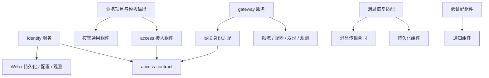

# 脚手架整体研发结构

## 状态与依据

2026-10-15 用户确认同仓库代码与文档分目录、分别检查；整体结构 D01—D04 及 S01—S06 的确认来源与精确输入见[结构确认与 R1 授权](../tasks/minimal-engineering.md#结构确认与-r1-授权)。产品主体及注册范围按[产品定位补充确认](../product/rebuild.md#产品定位补充确认)更新，具体单元进度与操作授权以[当前恢复点](../product/rebuild.md#当前恢复点)和唯一任务记录为准，不在本设计重复维护。

依据为[产品目的](../product/product-definition.md#产品目的)、[版本化复用边界](../product/product-definition.md#已确认的产品边界)、[起步交付](../product/product-definition.md#新项目起步交付)、[模块组织原则](../standards/system-design.md#逻辑模块与依赖门禁)和[制品与独立消费](../standards/technology-and-build.md#制品与独立消费)。本设计落实已确认产品范围的研发结构，不提前填写未确定的框架、服务商或业务合同。

迁移前 `ce20ca6` 是根目录最小 Boot 工程及质量接入的技术候选，尚未获工程人工验收。它的真实构建、运行、CI 和 delivery 结果保留，但不能证明整体研发结构已经合适；后续路径和构建边界变化须重新验证。任务状态只维护于[唯一任务记录](../tasks/minimal-engineering.md#唯一任务记录)。

已有规范的执行遗漏及原语义评审结论的纠正见[前置设计遗漏与整改](../tasks/minimal-engineering.md#前置设计遗漏与整改)。本文落实具体对象、关系和顺序，不重新定义 DDD、安全、事务或验收规范。

| 设计输入 | 当前事实及使用边界 |
|---|---|
| 需求 | [产品定义](../product/product-definition.md)、本会话最新指令可用；首版范围继续完整保留 |
| 源码 | `code/` 已有技术探针、Web 组件、BOM 和独立消费验证工程，结果及缺口见 [R2 任务](../tasks/reusable-web-component.md#唯一任务记录)；IAM 和完整业务模板尚未交付 |
| 设计与规范 | 本页、[最小工程设计](minimal-engineering.md)及本轮已确认规范可用；第五层工具夹具不能决定产品模型 |
| 公开接口 | Web 组件合同见 [R2 设计](reusable-web-component.md)；身份、注册、授权及其余组件 API 待对应单元设计，不将下文的职责命名当成已发布接口 |
| 数据 | 已有数据归属、事务和安全生效原则；产品表结构、IAM 聚合边界及跨存储协调方案尚未形成 |
| 部署 | 已确认 Linux／Compose 单机参考责任；实际产品部署及恢复证据尚无，下文为已确认设计拓扑，仍待相应单元实现验证 |

## DDD 边界与代码映射

采用[现有领域识别与建模规则](../standards/requirements-and-domain.md#领域与上下文识别)，先解释业务目标、语言和规则归属，再决定代码与部署位置。平台的价值在于让项目稳定复用通用能力；业务项目的核心领域由其自身需求决定，当前不预设订单、库存等业务上下文。

产品定位为微服务脚手架：身份、网关及消费项目的业务服务具有独立运行和发布边界；业务模板提供服务起步工程，服务内部按上下文和职责组织。沿用 D01 的拆分依据，不将一个企业业务项目限定为一个进程，也不机械地为每个上下文、实体或技术组件生成服务。

| 问题范围与所有者 | 推荐语义边界 | 代码／制品／部署映射及理由 |
|---|---|---|
| 项目内身份与访问治理；平台维护模型，各项目维护自己的数据与策略 | 一个身份权限限界上下文：注册与账号、会话有效性、角色、组织／部门、操作权限、菜单按钮声明、授权的数据范围及必要审计 | `services/identity/` 内一个构建模块，以实际职责组织包，交付一个可部署制品；这些概念共同参与项目内访问治理，当前没有按账号、角色、部门分别拆上下文或服务的语义依据 |
| 消费项目业务；各项目业务负责人 | 按项目业务语言形成自己的上下文，拥有资源及业务不变量 | 起步模板支持同一应用按上下文包组织；只有独立复用、发布或隔离需求才拆构建模块／服务，不以 DDD 为由强制微服务 |
| 持久化、缓存、文件、消息、通知等通用支持；平台能力维护者 | 当前先定义技术能力及公开合同，不把每个组件名字直接认作业务限界上下文 | 交付按需依赖的组件 JAR；有真实状态规则的能力仍需建模，例如验证码消费和消息恢复，但不因此生成全局业务模型 |
| 统一入口；平台维护，项目配置 | 协议与运行边界，不拥有下游业务模型 | `services/gateway/` 为独立运行单元；转发、身份衔接、限流、链路关联有独立运行责任，不承接资源权限或数据范围决策 |

首版自研平台应用推荐仅身份权限和网关两个；数据库、Redis、Nacos、消息中间件及所选任务框架的现成管理端属于运行依赖，不因此成为自研微服务。IAM 与通用能力以成熟框架实现已确认合同，业务差异保留在项目上下文，不自研通用身份协议、ORM 或消息引擎。

上下文关系按下表固定方向，协议类型与内部领域对象分开：

| 上游／下游 | 协作语言与翻译责任 | 数据和失败责任 |
|---|---|---|
| 身份权限 → 项目业务上下文 | IAM 提供公开服务与版本化交换合同；业务接入适配器把主体标识、操作权限和授权范围翻译为本上下文所需事实 | IAM 不拥有业务资源；业务用例组合当前授权事实与自身资源归属判断，不能把 IAM Account、Role 或持久化对象作为本地领域对象 |
| 身份权限 → 网关 | 网关采用身份校验合同，不复制 IAM 规则或会话库结构 | 网关只对其入口责任负责；后端继续校验，绕过网关不能获得额外权限 |
| 平台组件 → 项目用例／基础设施 | 技术无关公开能力可按[出口复用原则](../standards/system-design.md#出口端口与平台能力复用)直接使用；特定业务语义由项目自己的出口和适配器翻译 | SDK、技术错误和持久化对象不穿透业务合同；组件失败不能被冒报为业务成功 |
| 业务上下文 A → B | 同进程调用已声明的公开用例合同，或采用明确的服务／集成事件合同；下游负责翻译 | 不访问对方私有表，不共享可变实体；跨上下文一致性遵守[既有事务规则](../standards/system-design.md#本地事务与跨上下文一致性)，不统一强制异步化 |

IAM 的“账号”表示登录与授权主体；业务中的客户、员工等概念是否与之关联由该业务决定，仅引用稳定标识，不扩充一个跨项目、跨上下文的万能 User。聚合仍由不变量决定：账号、角色、部门是候选模型概念，不能因表或目录存在就认定一个聚合。禁用、撤权、改密和审计异常场景先形成详细模型，再决定保存边界与协调机制。

业务上下文建议使用下列包职责；这是命名与依赖方案，模板不生成无职责的实体、仓储或空接口：

```text
<项目根包>/
  bootstrap/                         # 应用装配
  <上下文>/
    interfaces/                      # HTTP、消息、任务等入口适配
    application/                     # 用例、必要入口／出口合同及编排
    domain/                          # 有场景依据的实体、值对象与领域规则
    infrastructure/                  # 持久化、SDK、协议转换及出口实现
```

入口依赖应用公开用例；应用依赖自己的领域与必要出口；基础设施实现相应协议；装配选择实现。领域不依赖 Spring、HTTP、ORM 或平台客户端，应用的必要 Spring 装配／事务注解按[已确认例外范围](../standards/system-design.md#已确认的应用层框架边界)使用。简单维护可采用轻量用例，复杂生命周期须由模型维护规则，不机械套用四层对象数量。

| 场景 | 业务结果 | 限界上下文 | 命令／查询／事件 | 前置条件 | 成功／失败／非法结果 | 不变量所有者 | 模型元素 | 外部协作 | 证据 |
|---|---|---|---|---|---|---|---|---|---|
| 账号禁用或撤权 | 后续新授权不能沿用旧状态 | 身份权限＋使用该事实的业务上下文 | 禁用／撤权命令、当前授权查询 | 可信管理身份及管理权限 | 生效条件满足后才报成功；无法取得当前依据则拒绝相关操作 | IAM 负责生效；业务负责资源判断 | 主体状态、授权关系；聚合边界待单元设计 | 状态存储与业务接入组件 | [生效原则](../standards/security-and-access.md#已确认的账号与权限变更生效原则)，尚无产品实现证据 |
| 密码变更 | 新密码可登录，所有旧会话无法通过新校验 | 身份权限 | 改密命令、会话校验 | 合法操作及旧状态校验 | 跨存储部分完成不报完整成功；不影响其他账号／项目 | IAM | 凭证、会话有效性；不把 Redis 当领域模型 | SQL 与会话存储 | [密码与会话原则](../standards/security-and-access.md#已确认的密码变更与会话原则)，协调方案待设计 |
| 访问业务资源 | 操作权限与资源／数据范围同时满足 | 业务上下文 | 业务用例＋当前授权查询 | 可信主体、当前授权及资源事实 | 仅有登录或经过网关不能放行越权资源 | 业务上下文 | 本地资源模型＋主体标识 | IAM 公开合同 | [职责规范](../standards/system-design.md#职责与依赖)，具体业务场景由项目定义 |
| 安全管理变更时审计保存失败 | 变更实际结果明确，审计缺口可识别 | 身份权限 | 管理命令、审计记录／补录 | 授权与变更生效条件均已满足 | 不只因审计失败阻断变更；不虚构审计完整 | IAM | 管理结果与审计事实分开 | 审计保存及故障告警 | [已确认审计责任](../standards/security-and-access.md#已确认的安全管理审计失败原则) |

本节是总体设计的战略边界和场景切片，不宣称 IAM 的完整战术模型已完成。首个 IAM 单元必须补齐聚合／生命周期、所有写入及失效路径的详细设计；目录搭好或架构检查通过不能代替该工作。

## 仓库分区与管理边界

已确认目标目录如下；未实现能力不创建空模块占位，R1 实际落位及验证见任务清单。

```text
domain-forge/
├── README.md                 # 简短导航与工作入口
├── AGENTS.md                 # Agent 入口
├── code/                     # 产品与可执行验证工程
│   ├── pom.xml               # 仓库内部 parent 与聚合，不强制消费项目继承
│   ├── .mvn/、mvnw、mvnw.cmd # 官方 Wrapper 与产品构建入口
│   ├── platform-bom/         # 已交付平台制品的版本组合
│   ├── components/           # 按能力交付的可复用组件
│   ├── services/             # 有明确部署责任的应用及装配
│   ├── templates/            # 可独立初始化的业务工程模板
│   ├── verification/         # 技术探针及独立消费验证源码
│   └── deploy/               # 可执行部署模板与脚本
├── docs/                     # 文档唯一正文
│   ├── product/              # 产品定义与重建路线
│   ├── standards/            # 长期规范
│   ├── workflow/             # 研发与文档流程
│   ├── design/               # 系统、能力及具体实现设计
│   ├── contracts/            # 面向消费者的合同说明
│   ├── guides/               # 开发、接入、运行、升级说明
│   └── tasks/                # 唯一任务事实与证据入口
├── tools/                    # 文档检查、工程检查及其校准工具
├── .github/workflows/        # CI 编排
└── .run-artifacts/           # 忽略的运行证据和临时产物
```

产品源码、测试、资源、迁移 SQL、可执行模板和部署配置属于 `code/`，不得放进文档目录来避开代码检查。业务规则与能力合同正文属于 `docs/`；代码中的注释及必要操作入口不复制整份规范。可执行 API 模型等合同源随代码管理，文档引用或由其生成；不手写两份同权合同。

`tools/` 是工程工具代码，仍需相应测试和质量检查，不作为产品组件发布；第五层校准夹具继续与产品实现分开。根目录保留工具必须识别的入口和配置。现有 README 产品正文及 REBUILD 正文迁入 `docs/product/` 时，须同步更新文档 ID 到路径的映射和全部链接；保留原确认来源及对象，不复制第二份有效正文。

同仓库分区不等于独立演进合同：一个功能变更的代码、设计、合同和使用说明在同一提交或 PR 中对应；纯文档修订可单独提交。对外制品固定版本并关联相应提交和说明，文档不另设一套产品版本或验收记录。

## 产品交付单元与依赖

推荐组件按下表分开按需消费。表中名称是拟定逻辑模块和目录，尚非已发布坐标；没有声明的组件间依赖不默认允许。外部 SDK／中间件依赖与平台内部依赖分别维护。

| `components/` 下的能力 | 责任与公开边界 | 允许的平台依赖／运行前提 |
|---|---|---|
| `web-support` | 统一 HTTP 结果、错误映射及 Web 装配；不决定业务权限 | 不依赖其他业务能力；依赖所支持的 Web 框架 |
| `persistence` | 关系访问、单库事务、迁移和多数据源接入；业务 PO、Mapper、迁移归所属应用 | 无平台能力依赖；声明的数据库及既定持久化工具，不提供跨库原子性 |
| `cache` | 缓存读写、过期、失效与失败合同 | 无平台能力依赖；缓存运行依赖在能力设计锁定 |
| `lock` | 跨实例互斥及使用前提 | 不依赖 `cache` 的业务 API；可复用同一成熟底层客户端，锁语义单独验证 |
| `rate-limit` | 配额判定、拒绝及失效行为 | 不依赖 `lock` 或身份模型；调用方传入明确可信的限流维度 |
| `idempotency` | 操作标识、执行状态与重复请求结果合同 | 不把 `lock` 当幂等证明；状态持久性、业务事务衔接及失败恢复在本单元设计明确 |
| `file` | 文件上传、下载、删除、必要信息与安全访问；业务关联和授权归调用方 | `file-api` 为技术无关合同；`file-local`、`file-s3` 只依赖该 API，二者不互相依赖，默认本地；首版两者均须验证 |
| `messaging` | 发布、消费与业务保存后发送恢复 | 基础传输组件无平台依赖；明确拆出的恢复适配依赖 `persistence` 和传输合同，在发送方本地事务中保存恢复记录，不依赖 IAM 或远端业务数据库 |
| `scheduling` | 任务执行接入与已承诺的运行期管理 | 无其他平台能力依赖；优先复用所选框架管理能力，不新增自研任务中心 |
| `notification` | 短信发送合同和服务商适配 | 无其他平台能力依赖；服务商未选，不承诺邮件实现或消息中心 |
| `verification-code` | 生成、校验、过期、使用限制与消费状态 | 发送路径使用 `notification`；状态存储遵守验证码合同，不借 `cache` 普通过期语义替代一次使用约束；不依赖 IAM、不增加短信登录 |
| `configuration` | Nacos 权威配置的加载、必要输入和已支持的动态生效 | 无其他平台能力依赖；不建立备用业务配置权威 |
| `discovery` | Nacos 注册、发现和实例变化 | 与 `configuration` 分别选择和验证；可复用技术客户端配置，不要求启用发现才能使用配置 |
| `observability` | 应用日志、健康、指标、链路接入和故障隔离 | 不依赖 IAM，不提供默认观测存储／看板，不承担 IAM 安全审计数据所有权 |
| `access` | 身份／授权交换合同、后端接入及原生声明的统一执行 | `access-contract` 不依赖 IAM 实现；后端接入适配依赖该合同和既定 Sa-Token；网关协议适配按实际技术栈独立选择，不传递引入不适用的 Web 容器 |

通常一个能力先交付一个 JAR，以公开 `api` 与内部实现／装配包区分，自动依赖检查保护边界。只有明确调用方或实现选择需要才拆 API、适配、starter 制品；上表文件的两种实现、消息的可选恢复适配、身份服务与客户端共用的协议合同已有拆分依据。领域／应用／基础设施不机械拆成四个 Maven 模块，也不建立装入所有能力的通用 starter 或万能 common。

服务及验证对象的组合关系如下；“可选择”不免除首版交付责任：

| 对象 | 必需组合及所有权 |
|---|---|
| `services/identity` | IAM 模型及其数据迁移；使用 `access-contract`、`web-support`、`persistence`、`configuration`、`observability`；Sa-Token／Redis 属于其身份实现依赖，不能因用了 Redis 就依赖普通缓存 API。发现按部署启用 |
| `services/gateway` | 选定网关运行框架＋网关身份适配＋`rate-limit`、`configuration`、`discovery`、`observability`；不引用 identity 的代码，不默认依赖 persistence 或业务模板 |
| `templates/business-service` 输出 | 一个业务项目拥有的 Boot 工程，默认接入 Web、身份、配置与应用观测；持久化、发现及其他能力按需求选用；不包含 IAM 实现或业务领域模型 |
| `verification/boot-smoke` | 现有最小探针的建议落位，验证技术链；不作为平台服务或业务模板发布 |
| `verification/consumers` | 初始化两个互不引用源码的项目，以明确仓库地址获取固定版本制品；禁止通过 reactor、相对路径或未声明的本地 install 假装独立消费 |
| `deploy` | 平台服务及已选自建依赖的 Compose 模板、持久化／备份恢复／升级回退脚本；项目密钥和业务配置不打入通用制品 |



图中是代码依赖，不是部署或 RPC 图；BOM 只管理版本。合法例：应用使用文件公开合同、S3 适配实现该合同。非法例：领域实体依赖 S3 SDK、业务服务读取 IAM 私有表、缓存组件依赖 identity 服务、组件依赖模板、两个组件互相引用。运行期直接数据访问和授权语义仍需场景验证。

## 身份权限部署与调用方案

推荐每个项目拥有并运行自己的身份权限服务；同项目多个业务服务共享本项目 IAM 的公开服务。这里的“每项目一套”表示数据和发布责任，不预定只能运行一个进程，也不新增高可用承诺。平台交付后端管理与接入合同，管理页面仍由项目实现，不新增管理前端。

| 方案 | 收益、代价与判断 |
|---|---|
| 每项目独立 IAM 服务，推荐 | 登录、管理、会话及授权状态有统一所有者，业务项目可独立升级；增加一个服务和授权调用成本，受保护操作依赖该服务可用性 |
| 每个业务服务嵌入整套 IAM | 单应用启动较少进程，但多业务服务时容易形成多套写入入口、状态与升级责任；首版不同时维护此形态。若将来确有单体嵌入需求，单独设计验证 |
| 多项目共用一个统一账号／认证中心 | 会引入跨项目身份、隔离与集中发布的新合同，不符合当前项目独立责任及非 OAuth 中心边界，本轮不推荐 |

推荐拓扑为同一项目内 `gateway → business-service`，网关和业务后端分别通过身份接入查询 `identity`。IAM 独占账号权限库和会话状态的写入入口；业务后端不得直接读 IAM 表或依赖 Redis 内部键结构。每项目使用独立逻辑数据库及凭据；生产参考默认独立会话 Redis 实例，项目内其他能力不复用 IAM 状态凭据。共享物理数据库服务器可以按独立数据库与权限隔离设计；跨项目共享 Redis 实例不是默认受支持方案，不能只凭 key 前缀宣称隔离。

身份状态仍复用已确认的 Sa-Token 与 Redis，HTTP 仍只使用已确认的 Bearer Header；不变更为 JWT、OAuth 或跨项目单点登录。首版推荐业务后端按每次新授权取得 IAM 当前有效依据，不缓存跨请求的“允许”结果；IAM 自身执行本地身份用例，不经客户端反向调用自己。网关检查不能取代后端检查；传入的身份 Header 不作为可信主体，内部身份查询还须认证调用服务并限定项目范围。具体服务认证机制、超时和连接预算在 IAM 接入详细设计固定。

IAM 负责账号状态、会话有效性、角色／操作权限和授权范围；业务用例负责自身资源归属及数据过滤，并由本上下文把范围含义映射到自身模型和查询，不能承诺通用 SQL 改写自动覆盖任意业务。两者组合才形成最终业务授权，禁止把 IAM 返回“已登录”或一次网关放行解释为完整访问权限。原生声明解析和默认拒绝继续使用既定规则，不能把远端调用改造成未经验证的自定义注解框架。

选择在线校验的代价必须接受：IAM 或其必要存储不可用时，相关受保护操作拒绝或报告依赖不可用，不沿用旧允许状态；按合同匿名且不依赖 IAM 的操作不应因此整体失效。此选择有额外延迟和负载，首个 IAM 单元须实测；未来优化也必须保持撤权和改密的生效合同，不能以 TTL 放宽要求。

禁用、撤权、缩小范围或改密的“成功”仍按既定生效条件判断。在线 RPC 本身不证明 SQL 与 Redis 原子更新，也不保证多实例读到当前状态；详细设计须覆盖并发读写、部分失败、未知结果、恢复及重试。审计保存故障继续执行既定容错责任，不被混同为允许忽略授权状态失败。

在实现完整 IAM 前，先用最小真实集成验证 Sa-Token 原生令牌读取、声明执行与远端当前状态合同能正确协作，并验证跨实例撤销、直连后端、跨项目令牌、状态存储故障和敏感输出。若既定框架无法满足该组合，明确回报架构问题；不静默改为共享表、长期权限缓存或复制会话实现。该验证属于设计确认后的 IAM 单元，不在本轮执行。

## 模板与版本消费方案

首版推荐只维护一个 `business-service` 业务模板。它交付项目自己的 Wrapper、POM、启动与配置入口、必要测试和按上下文组织业务的约定；IAM、网关以版本化服务制品交付，不各自增加可复制内部实现的业务模板。

模板使用已批准目录约定，尚无业务时只生成启动和接入所需内容；不为展示 DDD 自动生成 Account、Order、空聚合、仓储及领域事件。说明书给出上下文落位和依赖示例，行为示例放在独立验证夹具。生成后的业务源码和配置归项目所有，平台升级通过依赖及迁移说明完成，不覆盖项目业务源码。

初始化先采用固定版本模板包与有限参数替换，参数只覆盖坐标、包名和已支持能力选择；模板版本、输出输入及生成后检查须可追溯。不先研发通用低代码生成平台，也不把代码复制平台实现作为能力接入。具体执行命令在模板单元固定并从空目录验证。

推荐首版采用一条平台兼容发布线：本次发布的组件、BOM、服务与模板用同一版本标识，BOM 只列实际交付并验证的坐标，发布清单记录精确制品散列和文档提交。内部 parent／聚合配置不成为消费项目必须继承的 parent；消费项目显式导入 BOM 并选择依赖，也可以按兼容矩阵独立安排升级。统一版本不等于强制所有项目同步发布，未实现组件不占用发布坐标。

依赖管理 import 和构建 parent 是不同机制；BOM 的用途参考 [Maven 官方依赖管理说明](https://maven.apache.org/guides/introduction/introduction-to-dependency-mechanism.html#bill-of-materials-bom-poms)。最终 POM、插件与服务协议仍须实际消费验证，不能只凭 BOM 版本号认定整个组合兼容。

2026-10-16 用户确认内部 parent＋Boot BOM：`code/pom.xml` 同时承担当前仓库的父 POM 与实际模块聚合，坐标保留 `org.domainforge:domain-forge-build:0.1.0`，不再继承 Spring Boot parent。它通过 `dependencyManagement` 导入 Boot BOM，集中管理 Java、编码和构建插件；仅管理版本与构建约定，不向子模块自动加入 Web、数据库或安全依赖。可执行模块显式启用 Boot 插件及重新打包，普通组件不因继承而变成 Boot 应用。独立消费验证工程仍应使用消费方自己的 parent，不能通过内部继承替代独立消费。当前探针的具体 POM 与验证合同见[最小工程设计](minimal-engineering.md#工程组织与方案比较)；对外 `platform-bom` 已在 R2-01 与首个真实组件一同落地，范围及结果见该单元记录。

## 分别检查与关联验证

以下是已确认检查职责；具体入口和支持范围随 R1 迁移验证，不以设计确认代替实际检查。

| 变更 | 必需检查 |
|---|---|
| 文档正文与任务事实 | 文档登记、链接、索引、状态及语义评审；不默认执行无关的全量产品构建 |
| 产品源码、资源、构建、模板或部署资源 | 实际受影响产品的源码、架构、构建、测试、依赖扫描和运行场景；适用设计及说明的一致性检查 |
| 规范、合同或质量规则发生语义变化 | 除文档检查外，识别受影响组件、服务和消费场景并验证；不能因扩展名是 Markdown 就跳过 |
| 工具、校准机制或 CI 编排 | 对应机制正反例及其真实产品使用路径；共享检查输入触发受影响产品检查 |
| 候选交付 | 汇总必要 job／step，绑定精确代码、文档、制品及 CI 对象；人工验收单独保留 |

沿用已有文档入口与产品完整检查入口的核心逻辑，分别接受明确工作根和目标输入；CI 调用同一入口。迁移须检查旧路径残留、未知路径、漏分类、空目标和遗漏模块等失败情况，不新增一套重复的质量规则或放宽既有断言。

## 研发顺序与当前迁移

推荐先形成能被独立消费的短链，再补齐首版全部能力；不要求先完成所有基础组件才验证消费。下表是依赖顺序与单元退出结果，不是允许跳过单元详细设计的实现任务清单。

| 顺序 | 前置条件、工作范围 | 本单元退出结果 |
|---|---|---|
| R0 整体结构审阅，已确认 | 对照已有要求关闭设计遗漏，审阅 D01—D04、DDD 映射及 S01—S06 | D01—D04 及 S01—S06 已确认，来源见任务记录；只授权当前 R1 |
| R1 结构迁移与工程基线，已验收 | R0 确认；只迁移真实已有工程与必要文档，建立代码聚合、Wrapper、`boot-smoke` 落位，适配路径分类／检查／CI | 新候选的 E01—E12 及迁移相关 S 条件验证；必要目录按实际内容创建，旧候选仅作对照 |
| R2 最小可消费基础，当前实施 R2-01 | R1 验收；分别完成 Web 合同、Nacos 配置、最小应用观测、IAM 所需单库迁移与持久化的具体设计和基础实现 | 第一批真实组件及 BOM，通过声明的验证制品仓库由两个独立目录消费；模板雏形先验证初始化／构建／配置，不宣称完整平台接入 |
| R3 身份权限完整闭环 | R2 必要能力可用；先完成 IAM 模型、注册规则、状态一致性和接入协议设计，再验证 Sa-Token／远端合同，随后交付登录注册、账号角色组织／部门、菜单按钮、权限与范围及审计 | 两个项目使用各自 IAM 与状态存储；验证注册及初始授权、允许／拒绝、撤权改密跨实例生效、项目隔离和故障。IAM 会话不等待普通缓存组件，审计不等待异步消息能力 |
| R4 网关与起步接入 | R3 合同稳定；补发现、限流及完整链路观测，完成网关具体设计和组合 | 一个模板支持业务后端接入，网关和直连后端各自拒绝越权；两个独立消费项目验证固定版本组合与自主升级 |
| R5 首版能力补齐 | 对每项当前能力先设计合同再实现；在 R2 基础上完成多数据源及持久化余项、缓存、锁、幂等、文件本地／S3、消息及恢复、任务、短信／验证码、配置动态生效和观测余项 | 各能力有真实成功、失败、扩展及消费证据；消息恢复依赖单库事务与传输，验证码发送依赖短信，锁／缓存／幂等互不以名字暗示保证。R3／R4 引用的能力先满足其使用合同，不把 R5 当遗留空项 |
| R6 首版组合交付 | 前述所有已承诺能力通过；部署模板随各单元维护，最后验证完整组合 | 两个项目独立消费、升级及受支持版本组合；Linux／Compose 启动、持久化、备份恢复、升级回退、真实性能验收及完整接入文档，之后提交首版验收 |

R2 的验证仓库必须是声明的制品获取途径，可为隔离的本地文件仓库用于研发验证；不能用平台源码联合构建或开发者偶然的 Maven 本地缓存代替。对外发布目的地、凭据和实际发布仍按后续授权及发布合同处理。源码构建、消费者取包、真实部署和人工验收分别记录。

原 `pom.xml`、Wrapper 和 `src/` 已按 R1 迁移为 `code/pom.xml` 聚合及 `code/verification/boot-smoke/` 的实际探针模块；不要把原应用直接命名为 identity 或业务模板。README／REBUILD 正文迁入文档区时保持稳定文档 ID，精确更新引用、登记、读取入口、源码发现、扫描、CI 工作目录及 delivery 路径。迁移候选须验证原健康／生命周期及所有必要反例，不能借搬目录删除失败场景。

各单元可在前置合同稳定后独立研发，但正式推进仍遵守[既有验收后推进原则](../workflow/task-execution.md#已确认的验收后推进原则)。R1 的验收与收尾见唯一任务记录；当前 R2-01 已获设计及实施授权，从 Web 组件、BOM 与两个独立消费者开始，其他 R2 能力继续保留。上述后续顺序不产生业务扩展、外部发布、部署或 Git 写入授权。

## 推荐决定与待确认事项

已确认事项不重复请求：同仓库代码与文档分目录、分别检查；先总体结构后实施；现有产品首版范围、DDD／安全／工程规范继续有效。以下四项推荐方案已于 2026-10-15 获用户确认；保留当时取舍便于追溯。

| 决定 | 推荐方案 | 已确认的实际取舍 |
|---|---|---|
| D01 结构与 DDD 映射 | 本文分区、组件依赖表及上下文映射；平台应用首版为 IAM 和网关，业务模板默认同进程按上下文组织；必要的 API／适配拆分有明确调用方 | 接受这套组件／服务／模板边界及 S01—S06；不把所有能力拆服务，也不把所有能力塞进单一产品 JAR |
| D02 身份权限部署与状态边界 | 每项目独立 IAM 服务和状态资源，后端在线获取当前身份／授权事实，IAM 私有表及会话键不成为业务接入合同；首版不支持嵌入整套 IAM 或跨项目账号中心 | 接受额外服务、调用延迟及 IAM 不可用时相关受保护操作不可用的成本；不通过缓存旧允许状态换取可用性 |
| D03 版本与模板消费 | 一条兼容发布线＋平台 BOM；一个按需选择能力的业务模板；消费项目使用自身工程／parent 并独立选择升级时点 | 接受平台首版统一兼容版本的发布协调成本，暂不让每个组件建立独立发布节奏；不新增生成平台或其他技术栈模板 |
| D04 研发路线 | R0—R6；先结构迁移与独立消费基础，再 IAM、网关与模板闭环，随后补齐其余能力和完整部署验收 | 接受这一优先次序；所有首版能力仍须交付，R2／R3 的阶段通过不冒充首版完成 |

后续单元在实施前仍需固定：IAM 聚合与跨存储生效机制、注册开放方式及初始组织／权限、服务间认证和 API、网关及任务框架组合、短信服务商、尚未选定的运行依赖、真实性能门槛与制品发布位置。这些在当前结构中有责任归属，本文不将未知技术或业务策略写成已定事实；普通参数由调查及验证确定，影响产品合同／风险的取舍再集中提交对应决定。

## 结构验收条件

- S01：每项已确认首版能力能对应到所有者、语义边界、交付制品及部署责任；IAM／业务上下文的关系和翻译责任明确，技术组件不被机械当作业务上下文。
- S02：产品代码、文档正文、工具和临时证据各有唯一位置；根入口可导航，原规则、验收来源和证据仍可追溯。
- S03：给出合法与非法依赖示例，领域不依赖技术实现，组件不依赖服务实现、业务项目不复制平台实现或共享 IAM 私有模型；单个技术探针不能冒充模板或平台服务。
- S04：文档、代码与工具分别选择必要检查，规范／合同变更能触发跨区验证；未知路径、零目标和遗漏模块必须拒绝。
- S05：迁移保持既有行为和必要断言，重做路径与运行验证；本地和 CI 使用同一入口，证据绑定新候选。
- S06：研发顺序从整体结构到单元设计，再到实施、验证、人工验收；当前 E01—E12 作为最小工程技术标准继续保留，但不替代 S01—S06。

S01—S06 作为结构验收标准已获确认；R1 精确候选的实现验收与 E01—E12 证据见唯一任务记录，不外推为 R2 或首版平台已验收。

## 资料核对与结论范围

2026-10-15 对现有规范引用的一手资料作限定复核：[Fowler 的限界上下文说明](https://martinfowler.com/bliki/BoundedContext.html)支持先区分模型语境及关系；[Spring Modulith 的模块说明](https://docs.spring.io/spring-modulith/reference/fundamentals.html)展示公开接口、内部实现及依赖的区分，本项目未因此选择该框架；[Sa-Token 固定资料版本的权限说明](https://raw.githubusercontent.com/dromara/Sa-Token/v1.45.0/sa-token-doc/use/jur-auth.md)说明真实权限来源仍由应用接入，不证明本文远端状态组合已可用。

默认拒绝与每请求授权核对参考 [OWASP 授权指南](https://cheatsheetseries.owasp.org/cheatsheets/Authorization_Cheat_Sheet.html)。本文的每项目 IAM 拓扑、在线校验、组件组合和研发路线是结合当前产品约束提出的设计判断，不是这些资料给出的唯一方案，也不是已运行验证的事实。资料复核不改变已锁定版本或已有规范。
