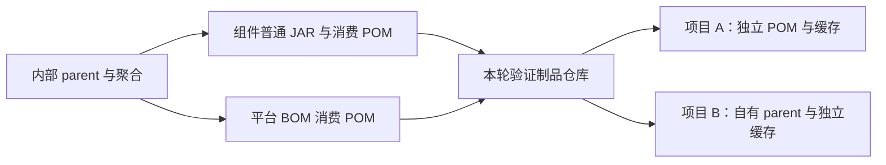

# R2 首个可复用组件、平台 BOM 与独立消费设计

## 状态与目标

状态：**R2-D01—D04 与 R2-A01—A12 已确认，实现已落地，当前为待人工验收的技术候选**。负责人：平台研发者；设计整理及验证责任：Agent。2026-10-16 用户确认 R1 候选 `6f6cea3` 验收，并要求收尾后先明确本设计，不开展业务实现。R1 的验收与收尾来源见[唯一记录](../tasks/minimal-engineering.md#唯一任务记录)，本单元决定与后续状态见[R2 任务](../tasks/reusable-web-component.md#唯一任务记录)。

目标：两个项目各自管理工程、构建 parent 和配置，通过固定版本 BOM 选择同一个真实组件，完成默认接入、公开扩展、真实 HTTP 及失败验证。组件修复不要求消费项目复制平台源码，也不强制其继承仓库内部 parent。

这是[研发路线](development-structure.md#研发顺序与当前迁移)中 **R2-01** 的已确认切片。R2 后续仍须完成 Nacos 配置、最小应用观测、IAM 所需单库迁移与持久化，以及对应模板雏形；R2-01 通过不等于整个 R2、IAM 或平台首版完成。已有 [DDD 边界](development-structure.md#ddd-边界与代码映射)、[组件规则](../standards/system-design.md#组件与扩展设计)、[HTTP 规范](../standards/api-and-errors.md)与[独立消费要求](../standards/technology-and-build.md#制品与独立消费)继续作为约束。

## 首个组件与范围

已确认首个组件为 `web-support`。它有明确使用者：后续 IAM 的 HTTP 入口及业务项目的入口适配；既有三字段响应和失败分类已确认，且首个消费闭环不需要引入数据库、Nacos 或远端身份服务。这里的 Web 支持是技术能力，不新增业务限界上下文、领域实体或通用业务异常父类。

| 方案 | 消费与维护成本 | 判断 |
|---|---|---|
| 只提供响应 DTO，各项目自行实现异常映射和框架接入 | 接口少，但重复维护错误映射，无法证明平台隐藏接入复杂性 | 不作为首个完整组件的退出结果 |
| 一个普通 JAR，公开结果类型与小扩展点，内部封装 MVC 默认装配及失败转换 | 可以真实验证默认接入与差异定制；范围限定于当前 Servlet 栈 | **推荐** |
| 拆成 api／autoconfigure／starter 多个制品，自动包装所有响应 | 增加版本与装配关系，且影响二进制和运维端点；当前没有第二种实现或非 Web 调用方 | 当前不采用 |

R2-01 包含：组件 JAR、平台 BOM、制品获取与接入说明、两个独立消费验证工程、真实 HTTP／OpenAPI 合同验证、适用质量与 CI 接入。WebFlux、网关适配、完整认证授权、数据库、通用重试、分页模型、业务 CRUD、完整模板生成及公共制品发布均不在本单元。后续能力的首版责任继续保留，不由本次切片删减。

## 公开合同与职责

以下名称是已确认的公开设计；实施后由有效 Java 声明及生成物维护合同，本文保留语义与责任，不手写第二份 OpenAPI。

| 公开面 | 责任与使用位置 |
|---|---|
| `org.domainforge.web.api.ApiResponse<T>` | 不可变三字段 HTTP 结果；显式构造成功、仅受理或业务拒绝。领域和应用用例不返回该类型，由入口适配器转换 |
| `org.domainforge.web.api.PlatformJsonApi` | 标记消费方选择接入的 JSON Controller；默认装配只处理明确接入的入口，不扫描业务包推断业务规则 |
| `org.domainforge.web.api.BusinessRejectionMapping<E>` | 消费方在入口适配层声明一个具体异常类型及其业务拒绝映射；只接受已明确判定的拒绝，不接管所有异常 |
| `org.domainforge.web.api.HttpFailureResponses` | 供消费方技术适配层显式构造协议、身份权限和服务失败响应；状态／稳定代码由组件提供固定分类，不能构造成 HTTP 200 |
| `org.domainforge.web.internal` 及装配包 | Spring、序列化及异常处理细节；不作为消费合同，构建检查拒绝消费者引用 |

响应遵守[既有外壳](../standards/api-and-errors.md#已确认的-json-响应外壳)：恰有 `code/message/data`，`code` 为非空稳定字符串，无数据也输出 `data:null`。不新增 `success`、时间戳或全局业务字段。`message` 仅供用户阅读，客户端判断依据是 HTTP 状态和 `code`。

| 场景 | R2-01 行为与责任 |
|---|---|
| 同步处理成功／查询无匹配 | HTTP 200＋`SUCCESS`；空列表和 null 等数据按该接口合同表达，不能按真假值判断成功 |
| 仅受理 | HTTP 202＋`ACCEPTED`；不表示任务已完成。本单元只验证表达及识别，不实现异步任务系统 |
| 已明确的业务拒绝 | HTTP 200＋业务方定义的稳定非保留代码；`data:null`，面向用户的安全说明；不输出部分成功或隐式重试承诺 |
| 已选中 Controller 的请求体／参数解析错误 | HTTP 400＋`INVALID_REQUEST`；不泄露原始请求、解析器详情或异常堆栈 |
| 显式身份／权限失败 | 公开响应工厂保留 HTTP 401／403 和 `UNAUTHENTICATED`／`FORBIDDEN`；这是结果映射，不执行身份判断。真实鉴权链仍由 R3 交付 |
| 已明确的服务不可用 | 显式技术适配返回 HTTP 503＋`SERVICE_UNAVAILABLE`；不能交给业务拒绝映射伪装正常拒绝 |
| 未知异常、扩展执行失败或非法映射结果 | HTTP 500＋`INTERNAL_ERROR`，固定安全提示；日志只保留必要诊断，不回传内部消息 |
| 路由不存在／方法不允许等未选择 Controller 的错误 | 保留宿主的 404／405 等 HTTP 语义；本单元不承诺统一其响应体，不安装接管整个应用的兜底 ErrorController |
| 二进制、流式、Actuator、合同文档及未接入入口 | 保持各自协议；不自动包裹，不读取流来拼外壳。响应已提交后无法改写时不得报告转换成功 |

`SUCCESS`、`ACCEPTED` 及上述平台失败代码为保留标识，业务拒绝映射不能占用。扩展按声明的**确切异常类型**匹配，不按异常名称、继承树或任意 cause 猜测业务含义；同一类型重复声明、声明 `Exception`／`RuntimeException` 等通用基类在启动时拒绝。未注册的类型走未知故障。扩展声明属于消费项目入口适配，不要求其领域异常继承平台类型。

F01 修复的内部诊断使用 JDK 日志接口，由消费应用现有日志配置接收，不新增日志后端或运行依赖。每个已转换的未知故障／扩展失败记录一条 ERROR 对应级别的诊断，包含固定分类、原异常类型、实际原因类型和代码位置；不读取异常 message、suppressed，不把原始 Throwable 交给后端，也不记录请求头／正文。最多四层原因、每层八个位置及 4096 字符，超限显式标注截断，不声称完整堆栈或全部根因已保存。正常业务拒绝和协议输入错误不计为系统故障；已提交响应仍交还宿主处理，避免组件重复记录。该单元验证默认消费配置的真实日志接收，不承诺用户关闭日志后仍有诊断、外部遥测完整送达或完整观测平台；日志配置责任遵守故障与观测规范。

默认装配使用 Boot 的条件自动配置，限 Servlet MVC；消费方添加组件依赖并标记 Controller 即可。无外部地址、凭证或数据存储输入。Controller 显式返回外壳，不通过全局响应拦截器把任意对象转成成功。组件只依赖当前 Web 框架及装配 API；支持这些框架的依赖按需要声明为 optional，消费项目显式选择 `spring-boot-starter-webmvc`，普通组件不强制带入可执行容器、IAM 或其他平台能力。

默认转换与项目自有全局异常 Advice 的优先级是实际接入风险：本单元禁止在同一已标记入口另装竞争的兜底 Advice；扩展走上述公开映射。启动／配置检查须识别可判定的冲突，真实请求验证最终生效处理器，不能仅凭 Bean 存在宣称默认接入成功。非 Servlet 工程不启用该装配，也不宣称该场景已支持 Web 能力。

## Maven 组织与平台 BOM

已实现位置如下：

| 位置／坐标 | 构建与消费边界 |
|---|---|
| `code/pom.xml`／`org.domainforge:domain-forge-build` | 沿用内部 parent＋聚合，统一 Java 与插件，不继承 Boot parent，不向子模块注入能力依赖 |
| `code/components/web-support/`／`org.domainforge:domain-forge-web-support` | 普通 JAR，继承内部 parent；无 Boot repackage 执行，无嵌入配置／密钥 |
| `code/platform-bom/`／`org.domainforge:domain-forge-bom` | 对外 POM，集中平台已交付组件与支持的框架版本；不提供应用源码、插件执行或 parent 继承要求 |
| `code/verification/consumers/project-a/` 与 `project-b/` | 可执行验证源码，各有独立 POM／Wrapper／测试；不列为平台 reactor 模块，执行时复制到两个仓库外空目录 |
| `code/verification/boot-smoke/` | 保留 R1 技术探针与既有断言，不把它更名为 IAM 或当成独立消费证据 |

平台 BOM 首批只管理 `domain-forge-web-support` 这一平台组件，并 import 已固定的 Boot 4.0.8 BOM；不列未交付 IAM、配置或持久化坐标。组件与 BOM 使用同一个不可变候选版本，本次为 `0.1.0-r2.1`；候选内容改变使用新版本，不覆盖相同 GAV。消费项目自己的版本与发布时点独立。

推荐依赖方向：内部 parent 继承／管理 Boot 基线 → 组件；对外 BOM 管理组件与 Boot 基线 → 消费方 import。内部 parent **不反向 import 本次平台 BOM**，避免组件自身版本回路。Boot 版本的维护源继续是内部 parent 属性，对外 BOM 的有效结果须与它一致，并由检查拒绝漂移；BOM 只管理版本，导入它不会自动添加组件或管理消费方插件。

组件的开发 POM 可以继承内部 parent，但交付 POM 不能要求消费方下载未发布的构建父模块。使用 Flatten Maven Plugin 生成独立消费 POM：组件解析必要依赖版本、移除构建 parent；BOM 保留 `dependencyManagement` 和所需属性，不能把 BOM 展平成空 POM。发布前检查无内部 parent、源码路径、未解析变量、动态版本、私有仓库地址或凭证；消费者通过真实模型解析验证，不能只搜索字符串判断有效。

BOM 的有效 Boot 版本及必需的继承属性必须进入其消费 POM；仅配置 `flattenMode=bom` 不算完成，须在不存在内部 parent 的仓库中实际解析。开发 POM 与生成的消费 POM各有用途，后者不得手工修订来掩盖来源或版本问题。

因此本单元验证仓库只需两种平台制品：组件 JAR＋消费 POM、平台 BOM POM；无需分发内部构建 parent。Flatten／deploy 等新增工具的确切版本、完整来源与校验已在本轮环境核查步骤固定；本次固定 Flatten 1.8.0、Deploy 3.1.4，核对官方 Maven Central POM／JAR 的 SHA-256 与仓库 SHA-1，见 `tools/product_gate/web-baseline.json`。现有 Java 21、Boot 4.0.8、Maven 3.9.16 和已锁插件保持，新增工具不能借此升级框架。

## 两个独立消费项目与使用路径

| 验证项目 | 自有工程与场景 | 需要证明的差异 |
|---|---|---|
| Project A | 自有单模块 POM，无平台 parent；import 平台 BOM，选择 Web MVC 与组件；显式成功／仅受理／拒绝、请求解析及故障场景 | 最小默认接入可用，消费者同时判断 HTTP 和业务结果 |
| Project B | 消费方自己的 parent＋应用模块，parent 只属于 B 项目；同样 import 平台 BOM；声明项目自有具体拒绝异常并注册公开映射 | 企业自有 parent 可保留；扩展确实生效且未复制平台实现，默认协议与故障处理仍正常 |



项目只是合同验证应用，返回明确标注的合成数据，不建立零售、账号、订单等业务实现。验证入口仅监听回环；未来业务接口按[访问策略规范](../standards/security-and-access.md#已确认的业务接口访问策略)另行接入。本单元的 401／403 场景是技术响应映射验证，不称为真实鉴权通过。

执行路径已固化为本地与 CI 共用的 `python3 -B tools/product_gate/verify.py --project .`：

1. 从精确平台输入构建普通 JAR、消费 POM、BOM；执行源码／架构／组件测试与扫描，记录版本、输入和文件散列。
2. 将这些制品放入本轮专用、显式配置的 Maven **验证制品仓库**，使用仓库外 `file:` 地址。它与构建者的 Maven 本地缓存是两个目录；写入完成后作为消费者只读输入，不建立常驻制品服务。
3. 从空目录分别初始化 A、B，只带各自源码、POM、Wrapper、必要测试和外部仓库设置；每个项目使用自己的 Maven 本地缓存，初始不含任何 `org.domainforge` 制品。第三方下载准备可独立复用，但必须声明来源，不能预种平台产物。
4. 分别以各自 Wrapper 构建，检查有效 POM、依赖树和实际平台 JAR 散列；不使用平台 reactor、平台源码相对路径、系统 JAR 路径或隐含本地 install。
5. 从各自打包结果启动到不同回环端口，运行独立期望的 HTTP 请求、默认接入及 B 的真实扩展；分别保存输入、结果、生成合同和日志。停止 A 不影响 B 的接入结果。
6. 在新的隔离验证副本中移除所需平台制品或使用不存在版本，确认消费失败；指向平台源码、内部包或遗留缓存的违规必须命中对应检查，不把其他错误当作反例成功。

这证明声明的本地验证仓库消费途径；不代表 Maven Central／私服已发布、真实两个业务项目已上线或跨版本升级已完成。当前没有历史 Web 组件版本，先保存首个真实合同基线；下一次真实组件变更再验证 A 升级、B 保持旧版，不能造两份相同 JAR 假称升级兼容。完整模板初始化属于后续 R2 单元，本轮用公开步骤从空目录建立验证工程。

## 质量检查与 CI 接入设计

沿用文档与产品分开入口。`tools/product_gate/verify.py` 已扩展至 R1 探针、Web 组件、平台 BOM 及 A／B 消费工程的实际产品清单、构建模型与运行场景；不能把“未知模块拒绝”改为忽略，也不能把新增产品源码重标为工具夹具。复用 `tools/engineering_gate/` 的成熟检查与固定 HTTP 工具，避免另建一套规则。

| 检查层次 | R2-01 具体责任 |
|---|---|
| 文档与任务 | 设计、合同、接入说明和任务关联；R2 设计确认、实现验证、Git／CI 及人工验收分开 |
| 源码与架构 | 平台及两个验证项目的实际生产／测试输入全部覆盖；普通 JAR、公开 API 与内部包、领域无 Web 依赖；注释及复杂度沿用原规范 |
| 构建与模型 | 固定 Wrapper／JDK／插件；组件与 BOM 精确模块清单、有效消费 POM、真实测试计数；skip、零目标、遗漏任一消费者或 Boot 错打普通 JAR 必须拒绝 |
| 真实 HTTP 合同 | 有效代码生成 OpenAPI 3.0.1；复用已校准的 springdoc 3.0.3、请求验证器和兼容工具，先核查实际产品组合；逐项核对真实注册入口、响应、消费者识别与独立期望 |
| 范围外协议 | 二进制／流式／Actuator 按原始字节、媒体类型及既有运行合同单独验证；不通过略去已声明入口使覆盖看似完整 |
| 依赖告警 | 平台和消费者实际解析的生产及测试依赖均扫描；相同依赖集合可明确去重，报告关联到各输入；告警、资料不可用与扫描失败分别记录 |
| 独立消费 | 分开的获取仓库、本地缓存、构建目录和运行端口；核对真实取得的坐标及散列，并执行必要失败反例 |
| CI | 组件、BOM、消费工程、对应设计／合同或检查工具变化触发完整适用产品验证；影响校验机制时执行其正反例；本地和 CI 调用相同入口 |

新增产品清单和独立消费流程不作为本轮设计变更提前实现。实现时先依据正常执行和冷启动下载测量分别安排预算；Maven／NVD 准备失败明确为环境未完成，不记成代码断言失效，也不能当作已验证通过。保留既有检查与断言，不以减覆盖换取更短 CI；不为本单元重跑无关能力全部上游测试。

## R2-01 验收标准

以下是**已确认、待执行**的验收条件，当前均无产品通过结论。

| ID | 必须观察到的结果与证据 |
|---|---|
| R2-A01 | 制品边界符合本设计：一个普通组件 JAR、一个 BOM、两个独立消费工程；无空能力模块、业务模型或 Boot 重新打包的库。有效 POM、JAR 内容和架构检查可核对 |
| R2-A02 | A 的最少依赖与声明即可默认接入；无需复制平台 Advice 或填写内部装配参数。实际打包程序的 HTTP 请求证明默认生效 |
| R2-A03 | 成功、空查询、明确拒绝和仅受理的 HTTP／三字段／稳定代码／null 数据准确；A、B 都能识别 HTTP 200 的拒绝，不以中文消息或 2xx 数量判成功 |
| R2-A04 | 400、显式 401／403／503、未知 500 映射不退化为 200；错误信息不泄露请求、堆栈或秘密；无有效响应不报成功。真实鉴权仍明确未在本单元验证 |
| R2-A05 | B 的具体异常通过公开扩展得到预期拒绝；未注册、扩展抛错／非法代码走 500；重复或过宽声明拒绝启动；默认映射回归通过 |
| R2-A06 | 未接入入口、二进制／流式和运维端点协议保持；冲突 Advice 不被默许；无 IAM／数据库／Nacos 配置仍能完成本单元，未支持协议不冒称可用 |
| R2-A07 | BOM 只列实际平台组件并使用固定 Boot 组合；组件／BOM 消费 POM 无内部 parent 或不可解析属性；仅凭两个公开平台坐标可解析构建，不强制消费方 parent |
| R2-A08 | A、B 分别从空目录及无平台缓存状态经声明仓库构建、运行，平台 JAR 与本次制品散列相同；B 自有 parent 保持，停止 A 不影响 B |
| R2-A09 | 漏任一消费者、借平台 reactor／源码／隐含 install、引用内部包、制品缺失／版本错误、同 GAV 内容覆盖、跳过测试均被相应反例识别；合法路径随后通过 |
| R2-A10 | 真实注册路由、生成 OpenAPI 和独立 HTTP 预期一致；首个版本合同与输入固定保存，手工改生成物／漂移／漏接口被识别；无历史版本时不假称升级验证已完成 |
| R2-A11 | 本地与真实 CI 对同一候选执行适用源码、架构、构建、测试、依赖告警和消费场景；R1 探针原断言仍通过；资料／环境缺失不报通过，告警如实保留 |
| R2-A12 | 语义评审核对公开责任、DDD 边界、扩展必要性和证据充分性；按有效 Git 授权提交候选并核对真实 CI／delivery，再取得精确 SHA 的人工验收。R2 余项、升级和公共发布保持未完成 |

## 实施顺序与待确认决定

建议顺序：确认本设计 → 固定新增工具及产品组合 → 组件合同与默认／扩展场景 → BOM 与消费 POM → 独立 A／B 获取和运行 → 适用检查与 CI → 语义评审及候选验收。故障修复先复现，默认与扩展实现先有独立可判定的场景期望。不先建设通用生成器或制品平台。

| 决定 | 推荐方案与需要确认的取舍 |
|---|---|
| R2-D01 | 首个单元选 `web-support`＋BOM＋两个独立消费者；R2 配置、观测、持久化及模板余项继续按后续单元交付 |
| R2-D02 | 一个普通 JAR，显式响应与 Controller 接入，具体业务拒绝映射；限定 Servlet MVC 和本文 HTTP 表，不全局包装，不让领域依赖平台 Web 类型 |
| R2-D03 | 内部 parent 留在构建端；BOM import Boot 并管理实际组件，交付独立消费 POM；统一不可变候选版本，从 `0.1.0-r2.1` 起，不发布空坐标 |
| R2-D04 | 本轮专用文件制品仓库＋一个无 parent、一个保留自有 parent 的消费工程，完成 R2-A01—A12；不把本地取包当公共发布，也不把首版基线当升级证明 |

上述决定及验收标准已于 2026-10-16 获用户确认；来源见[确认记录](../tasks/reusable-web-component.md#本轮确认与执行边界)。本轮实施组件、BOM 与消费验证，禁止业务扩展和提交推送。具体 Maven 新工具版本和装配 API 的可查技术事实由获准后的版本核查与真实场景固定；若实际组合迫使更改上述合同或风险，再提交受影响决定。

## 一手资料与证明范围

2026-10-16 复核：[Maven 依赖管理与 BOM](https://maven.apache.org/guides/introduction/introduction-to-dependency-mechanism.html)说明 import、传递依赖与 parent 的区别；[Flatten 官方目标说明](https://www.mojohaus.org/flatten-maven-plugin/flatten-mojo.html)说明消费 POM 生成、依赖解析和 BOM 模式；[Boot 自动配置文档](https://docs.spring.io/spring-boot/reference/features/developing-auto-configuration.html)说明条件装配和应用覆盖。这些资料支持机制选择，不证明本文组合已运行或具体版本已兼容。

首个组件、接口范围、版本策略与消费项目组合是结合本仓库约束的设计判断。现有 HTTP 校准来源见[工程门禁](engineering-gates.md#真实-http-合同校准)，现有产品版本见[最小工程基线](minimal-engineering.md#版本与支持环境)；它们不能代替 R2 的真实组件和消费验证。

## 当前实现与使用入口

新增工具／库按 `tools/product_gate/web-baseline.json` 固定；环境沿用 Temurin 21.0.12.1+1-LTS、Python 3.14.5、Maven 3.9.16、Boot 4.0.8。Springdoc 3.0.3、OpenAPI 验证器与 diff 工具沿用 `tools/engineering_gate/http-contract.lock.json`。组件的 OpenAPI nullable 声明使用与 Springdoc 一致的 optional Swagger annotations 2.2.47，不增加运行容器。源码编译、真实取包、生成模型和实际扫描分别提供来源证据。

独立消费方的最少接入是：在自己的 dependencyManagement import `org.domainforge:domain-forge-bom:0.1.0-r2.1`，显式添加 `domain-forge-web-support` 和 `spring-boot-starter-webmvc`；在入口 Controller 标记 `@PlatformJsonApi`，返回 `ApiResponse.success(data)`／`ApiResponse.accepted(data)`／`ApiResponse.rejected(code, safeMessage)`。B 的公开扩展示例位于 `code/verification/consumers/project-b/app/src/main/java/example/consumer/b/RejectionAdapter.java`，以 Bean 声明确切的异常类型，领域不依赖 Web 类型。两项目各自维护构建插件和 Wrapper。

完整验证从仓库根运行：

```sh
python3 -B tools/product_gate/verify.py --project . --environment
python3 -B tools/product_gate/verify.py --project .
```

环境需按既有产品基线设置 `JAVA_HOME`／`PATH`、`DOMAIN_FORGE_PRODUCT_REPOSITORY`、`DOMAIN_FORGE_PRODUCT_WRAPPER_CACHE`、`DOMAIN_FORGE_GATE_TOOLS` 和 `DOMAIN_FORGE_GATE_ADVISORY_DATA`。`DOMAIN_FORGE_GATE_HTTP_TOOLS` 可指向已核对的 HTTP 工具；未提供时使用已核对的产品 Maven 在隔离目录准备。第三方下载／NVD 资料准备失败单列，不能改写为代码断言失败或成功。

入口生成组件与 BOM 后使用真实 deploy-file 写入新的隔离文件仓库，每次消费前后验证仓库字节；拒绝覆盖已存在 GAV。A／B 从各自空目录和不含平台制品的缓存读取，消费记录、原生 Maven 观察、源码／架构检查、生成 HTTP 合同、打包运行及漏洞报告保存在返回的 workspace 中。CI 调用同一入口并保存必要日志，当前没有本轮远端 CI 结果。

首版合同位于 `docs/contracts/web-support/0.1.0-r2.1/`，由真实 Springdoc 生成并绑定源码／场景散列，检查当前重新生成结果与固定文件及 manifest 一致。该基线不得手改；真实版本演进另行定义新候选并生成新基线，本次不证明历史升级兼容。

消费端健康仅暴露无详情的 health；固定技术失败提示以独立断言核验，不能只匹配某一个秘密字符串。Advice 冲突检查遵循 Spring 实际有效方法解析，允许覆盖后收窄的处理器，继续拒绝生效的兜底竞争。组件、消费者编译模型及整个 reactor 的声明版本全部受既有检查约束。
