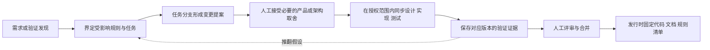

# 文档控制面

文档 ID：GOV-DOC。类型：治理方案。修订：v0.1。状态：Draft / 待评审。负责人：用户；编写：AI。日期：2026-09-20。依据：H02 及用户选择“先建立仓库内的文档治理机制”。本方案尚未获准生效；已有协作与授权规则继续适用。

## 1. 目标与边界

使 AI 和人工在任意任务节点都能回答：依据哪个版本做事、什么可以修改、哪些变化需要确认、证据在哪里、最终交付哪些内容。实现载体先采用 Markdown、Git 和现有 GitHub 流程，不建设可视化管理平台或自定义工作流引擎。

“控制面”是文档与决策的治理机制，不是新的运行时业务服务。成功标准是一个任务可以从目标追溯到已接受规则、变更、验证和交付版本；过程记录增长不增加权威规则副本；换一个 AI 也能从入口恢复任务。

## 2. 四类内容与存放边界

| 类别 | 回答什么 | 位置 | 能否约束实现 | 是否进入消费方交付 |
|---|---|---|---|---|
| 规划 | 为什么做、做什么、先后顺序、何时满足进入/退出条件 | `docs/roadmap.md`、`docs/planning/` | 范围与顺序获准后有效；不能创造产品规则 | 通常不随模板或二进制分发 |
| 设计与规则 | 系统应如何工作、允许依赖什么、为什么选择它、人员如何协作 | `docs/design/`、`docs/adr/`、`docs/governance/`、`AGENTS.md` | 仅已接受版本在其适用范围内约束实现 | 按发行清单选择必要规则和接入契约 |
| 过程记录 | 实际做过什么、发现了什么、哪次变更如何验证 | `docs/records/`、关联 Issue/PR/CI；原始执行追踪在 `.run-artifacts/` | 不自动产生新规则或批准 | 只保留必要证据引用，不打包全部日志 |
| 最终交付 | 某一固定版本实际提供的代码、使用文档、规则及限制 | 代码与测试的原位置、`docs/usage/`、`docs/releases/<version>.md` | 描述该发行的承诺与使用限制 | 明确列入交付清单的内容 |

最终交付不是另建一套“final”目录复制源码、设计和规则，而是以发行清单固定它们的版本。一个已接受的设计可以约束未来实现，但在实现验证完成前，不能写入使用说明宣称产品已支持。

`docs/governance/review-register.md` 是治理中的控制记录，登记批准对象与授权，不另写产品规则；其他调查、试验和变更过程按 `docs/records/` 分类。

规划中的“接入 S3”不是 S3 契约；过程报告中的“临时允许空部门”不是权限规则；一次测试通过只证明其声明的环境和场景。代码与已接受规范冲突时，应建立缺陷或变更提案，不能以代码已存在为由追认规则。

## 3. 权威来源与版本

权威位置见[文档入口](../README.md)，规则正文不在任务单、交接摘要和发布说明里重复维护。规划项引用设计 ID，过程记录引用任务与输入版本，发行清单引用实际源码、文档和规则版本。

区分四个维度：

| 维度 | 标识方法 | 不能混淆的含义 |
|---|---|---|
| 文档身份 | 稳定 ID 或 ADR/C/S/API/验收 ID + 路径 | 移动文件不更换业务规则编号 |
| 修订内容 | Git commit + 路径；评审中的内容用 PR head 或内容摘要 | 文件名/修改日期不能唯一定位批准对象 |
| 设计/治理基线 | 基线 ID + 人工记录 + 精确批准范围 | 接受旧快照不会自动接受后续 diff |
| 产品版本 | 发行版本 + 源码提交 + 交付清单 | 设计版本不等于已经发布的产品版本 |

本次 DESIGN-v0.1 的准确批准范围仅在[H02](review-register.md)登记。新增治理方案单独评审；本轮不重发或覆盖该快照，也不创建发行标签来模拟产品发布。

新增长期文档头部使用最小字段：ID、类型、状态、负责人、依据/关联、修订日期。新提案补充所替代基线；仅受影响文件逐步补齐，避免一次性批量格式迁移。文档状态在本文件头部维护；索引只导航；批准记录是状态变化的证据。

## 4. 生命周期与权限

| 内容 | 状态与进入条件 | 负责者 |
|---|---|---|
| 规划/设计/规则 | Draft → In review → Accepted；否决为 Rejected；被替代为 Superseded 并链接替代项 | AI 可起草和提交评审；用户接受、否决重大选择 |
| 过程记录 | Open → Closed；结论被新证据推翻时追加更正、标注 Invalidated | AI 记录事实与验证边界；涉及人工选择引用批准记录 |
| 研发任务 | 沿用[协作流程](ai-development-workflow.md)；设计接受、合并与发布各自判断 | AI 实施已授权任务；用户评审、合并和发布 |
| 发行清单 | Draft → Release candidate → Released；撤回需记录实际处置 | AI 汇集证据；用户批准发布，发布成功后才记 Released |

Accepted 指人工接受的精确修订。已接受文档的语义变更在任务分支标为 In review，指向旧基线与变更记录；被影响的实现继续引用旧基线，或等待新批准。批注与格式修正可以正常 PR 审阅，不要求重新确认所有设计。已接受 ADR 的实质取舍被推翻时新增 ADR，原记录转 Superseded，保留决定历史。

Merged 只证明 Git 合并发生，不能证明技术验证通过；测试通过不等于人工批准；用户一次通过整套文档时可以整体登记，不重复要求逐条点击。审阅后的新增实质变更需要针对新 diff 重新审阅。

## 5. 文档变更闭环

1. **识别**：判断是修订表达、改变规则、补齐细节，还是实现偏离。记录受影响的规范、ADR、契约、任务、测试和消费方。
2. **提案**：小修改在 PR 说明影响即可；跨多个规范或改变授权/数据/兼容语义时，建立一份 `docs/records/changes/CHG-<issue或短标识>.md`，不再另写同内容的评审包、总结和交接文件。
3. **接受**：新增产品规则、服务边界、依赖策略或权限语义交用户决定。事实调查和已经获准规则内的普通实现继续推进。批准绑定提交/摘要与范围，执行授权单独记录。
4. **同步**：规范与实现通常同一 PR；若分批，先接受目标规范并明确尚未实现、影响版本、依赖任务及旧版兼容边界。不得把未来行为混入当前发行的使用文档。
5. **验证与合并**：检查链接、状态、规则追溯及相关行为测试；证据绑定被测 commit、依赖版本、环境和方法。源内容或被测依赖改变后，评估并使受影响证据失效，重新运行相关检查。
6. **归档**：关闭过程记录，更新其结果和目标版本引用；发行时从已验证结果生成交付清单。未采用的方案保留理由，不流入当前规范。

并发修改同一规则时，后完成的分支对齐新主线并重新核对语义；Git 文本合并成功不代表两个设计能共存。发现未批准的安全语义冲突，只暂停受影响部分，继续无依赖工作。

例如未来有人提出改变“多个角色数据范围取并集”：先引用 C09、I02 与 D01–D08 分析影响，形成提案并请求用户决定；原已接受规则继续有效。若提案被接受，再同步领域模型、受影响 ADR/契约、实现与验收，并在发行清单标明授权语义变化。讨论记录本身不会改变权限算法，此例也不提出修改当前 C09。

## 6. 过程记录的规模控制与证据保存

| 过程材料 | 保存方式 | 关闭时处理 |
|---|---|---|
| 一次短任务计划、普通 PR 检查 | Issue/PR 中维护；未创建 Issue 时在近期任务表中登记 | 保留目标、变更理由、验收和最终版本指针，不再写独立总结 |
| 跨任务调查或兼容性验证 | `docs/records/investigations/<id>.md`；写问题、输入、方法、结果、限制、负责人 | 固定输入/结果摘要；规范结论另行接受后进入设计，报告继续作为证据 |
| 重要规则变更 | `docs/records/changes/<id>.md` | 链接批准记录、落地 PR/提交与受影响发行；保留被否决方案 |
| 原始工具输出、尝试日志、临时摘要 | `.run-artifacts/<tool>/<run>/`，本地忽略 | 不整体入库；有价值结论提炼为一份可审阅记录 |
| 大体积 CI 日志或测试产物 | GitHub 产物或受控制的证据存储，记录校验值与有效期 | 发行依赖的证据在过期前转入持久位置；无可靠存档时标为不可复核 |

过程文档不按每次工具调用产生，不复制整段聊天，不含秘密、Token、真实用户敏感数据或开发机私有绝对路径。人工记录仅摘录必要决定，不复制所有讨论。

Git 中保留的重要过程记录应足以在另一台机器理解与复核结论：包含环境版本、可复现步骤、结果摘要和持久证据指针。仅指向某台机器的 `.run-artifacts` 不能作为发行唯一证据。无法复测的结论明确受限，不能继续标为普遍有效。

不预设自动删除期限或自行删除历史记录。已关闭记录保留原身份，以状态和索引筛选；需要迁移路径时更新入链。曾交付版本引用的内容保留在对应 Git 历史中；包含敏感信息的历史不能只靠普通删除文件处理，应另行授权清理。

## 7. 最小记录格式

需要新记录时按下表选字段；小任务不同时创建四种模板。

| 记录 | 必需内容 |
|---|---|
| 任务 | ID、负责人、目标/非目标、输入基线、依赖、允许修改范围、输出位置、验收场景、状态、证据与交接 |
| 变更 | ID、起因、旧基线、具体差异、受影响代码/规范/验收/消费方、是否需人工决定、批准对象、落地状态 |
| 调查/验证 | 问题、被测 commit/版本/环境、方法、观察结果、结论适用范围、失败与未验证项、证据位置、负责人 |
| 发行清单 | 版本、源码提交、制品及摘要、文档/规则修订、测试证据、兼容与迁移/回退条件、未实现项、发布授权及实际发布结果 |

## 8. 最终交付：代码 + 文档 + 规则

| 交付集合 | 包含什么 | 验收依据 |
|---|---|---|
| 代码与制品 | 必要组件、IAM/Gateway、模板、构建配置、迁移、相关自动测试 | 与固定提交可对应；独立环境可构建/消费；场景通过 |
| 使用文档 | 创建项目、启动、配置、认证接入、API、扩展、升级与故障处理 | 按文档能完成目标旅程；参数与该版本实际能力一致 |
| 可执行规则 | 适用于消费项目的 AGENTS、领域/依赖约束、架构测试、已启用检查与相关配置 | 能指导下一位 AI；规则与检查对应；未自动化项明确为人工约束 |
| 交付清单 | 上述对象的精确版本、来源、证据、限制与授权 | 不引用“最新”浮动页面替代固定版本；不将未实现能力写为已交付 |

治理政策写在 `docs/governance/`；`AGENTS.md` 保持简短入口和确有必要的强约束；未来 CI/架构测试是这些规则的执行方式，不能默默另造一套政策。模板内的 AGENTS 按消费方生命周期编写，不能携带本仓库“当前仅规划”的临时阶段锁。公共规则升级通过可评审差异供项目采纳，不覆盖项目定制。

## 9. 文档检查与验收

本轮只进行静态文档检查和情景审阅。后续自动化在研发获准后落地，不为了治理文档提前生成 CI 或工具平台。

| ID | 情景 | 通过条件 |
|---|---|---|
| DC01 | 新 AI 接手任务 | 能找到授权、当前任务、固定输入基线及对应规范；不用遍历所有历史日志 |
| DC02 | 已接受设计发生语义变化 | 新提案与旧基线可区分；受影响任务、规则和测试可列出；无未批准规则混入实现 |
| DC03 | 过程记录数量增长 | 原始日志不入正式规范；同一结论只有一个当前权威来源；重要证据可跨机器复核 |
| DC04 | 文档已接受但实现/实测未完成 | 状态分别显示；没有发行或安全实现已完成的错误宣称 |
| DC05 | 两个任务同时改权限或契约 | 语义冲突被识别；后完成者重核基线与相关验证，不能只解决文本冲突 |
| DC06 | 发布或回退某个版本 | 能定位该版本代码、文档、规则、证据和限制；工作中的草案不覆盖旧版承诺 |
| DC07 | 新项目使用并升级模板规则 | 不继承上游临时阶段锁；公共规则升级保留项目定制与审阅机会 |
| DC08 | 证据链接过期或被测依赖变化 | 标出失效范围，修复证据或重跑相关检查；不沿用旧“通过”结论 |

上述为治理验收定义，不能被误记为自动化已实现。方案接受后，再按[项目规划](../planning/project-plan.md)逐步启用。
