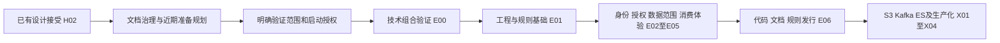

# 设计与研发路线

类型：规划路线。既有 E00–E06 与 X01–X04 路线随 DESIGN-v0.1 / H02 获得接受；本轮新增文档治理准备方案为草案。负责人：用户；整理：AI。当前所有研发切片均未启动；接受记录见[H02](governance/review-register.md)，近期任务状态只在[项目执行规划](planning/project-plan.md)维护。此处没有工期承诺。

## 1. 整体推进顺序

本轮聚焦[仓库文档控制面](governance/document-control-plane.md)，近期 PLAN-01–PLAN-05 覆盖治理、字段契约、工程设计、兼容性验证准备与启动检查。只有受依赖约束的步骤串行；接口细化和验证准备可以独立推进。远期能力到达对应阶段时再补充设计。

设计文档的 Git 初始化与个人 GitHub 私有仓库提交已由用户于 2026-09-20 单独授权，见 [H01](governance/review-register.md)。该操作提前开展文档版本管理，不表示 E01 的工程、构建或 CI 工作已启动。

## 2. 首批研发切片

共同前置：已确认的设计基线、当前切片的字段/配置契约、相应研发授权。输入中尚待评审的决策，不应由实现者自行决定。

| 切片 | 输入 / 依赖 | 具体输出与边界 | 验收 |
|---|---|---|---|
| E00 技术组合验证 | Q07、ADR-0005；正式编码前的验证授权 | 最小兼容试验及报告，冻结精确 JDK/BOM/server-client 版本；不开发 IAM 业务功能 | T-V01–T-V07 中与最小集成有关的部分；冲突保留证据并回到 ADR，不静默降级 |
| E01 工程与仓库基础 | E00、ADR-0002/0003、Q08、GitHub 前置 | 在文档仓库基础上初始化工程，按已确认分发方案补齐仓库；构建、架构检查、最小 CI、迁移和日志约定 | A01–A03、G01–G03；空环境可重复构建 |
| E02 身份纵向切片 | E01、S01/S05、API01–API04/API07、Q04/Q06 | 从初始化、登录到当前身份、退出、禁用、改密码与撤销会话；含权威状态与审计 | T01–T09、P05/P06、F01/F02/F04 |
| E03 授权与组织切片 | E02、S02/S03、API08–API11、I01–I06 | 角色、权限目录、用户绑定、部门树及授权判定；禁用/并发规则 | P01–P07、O01–O03，权限公式 D01–D08 |
| E04 数据权限纵向切片 | E03、ADR-0006、API05/API06 | 用户数据范围及测试专用资源消费；支持清单内 SQL、原子写入与失败拒绝 | D01–D15、F01–F04；真实 MySQL，不能仅 mock |
| E05 导航与消费体验 | E04、S06、API12、ADR-0001/0002 | 菜单按钮 API、独立消费服务夹具、接口文档、运行说明与可选组件 | N01–N03、T-V06/T-V07；直连与经网关鉴权一致 |
| E06 首个可复用发行 | E05、所有阻断问题闭合、人工发布授权 | 经评审的 BOM/组件、服务版本、轻量模板与发行/迁移说明 | T-V08、R01–R03、G01/G02；新项目不依赖平台源码 |

E00 只验证与兼容组合有关的最小机制，不能提前声称完整数据权限或生命周期验收通过；完整场景随 E02–E05 实现后执行。若 E00 改变版本或架构假设，先更新设计基线再进入依赖它的切片。

## 3. 后续技术能力路线

每项能力先补充一份有实际调用方的设计，再安排研发；下表规定投入顺序与边界，不提前冻结没有用例的 API。

| 阶段 | 目标 / 输入 | 交付边界 | 验收方向 |
|---|---|---|---|
| X01 S3 | E06；一个实际对象访问需求或技术夹具 | 可选 S3 适配、对象归属与预签名策略，不演变为文档业务系统 | 权限、上传/下载/删除、预签名到期、配置关闭和故障 |
| X02 Kafka | E06；明确事件语义与可靠性需求 | 可选传输组件、幂等与重试/死信约定；DB 与消息联合写时采用已论证 Outbox | 重复/乱序边界、崩溃恢复、至少一次语义，不虚称跨存储恰好一次 |
| X03 ES | E06；若使用事件同步则依赖 X02 | 可选检索适配、索引生命周期、授权过滤和重建 | 客户端/服务端兼容、分页/过滤、重建切换、同步故障 |
| X04 生产化 | 明确负载、预算、部署与运维团队 | 按证据设计 HA、备份恢复、指标目标和部署平台 | 达到单独确认的 SLO 与恢复演练目标 |

X01 与 X02 无强技术依赖；默认先完成 S3 以验证按需组件模式。若真实项目优先级变化，调整路线并记录理由，不要求为满足原表顺序投入无用能力。Redis 会话/通用缓存属于首批；Caffeine、多级缓存等由实测场景触发。

## 4. 任务进入研发前的检查

每个切片必须有设计版本、C/S/ADR/API 引用、验收 ID、可观察输出、明确非目标，以及所需环境和权限。缺失字段契约或产品规则时建立设计子任务，不能以实现“合理猜测”闭合。

用户确认设计基线只接受方案，不自动授予研发、生产部署或制品发布权限；启动、合并、发布按已确认流程分别执行。当前下一步是本轮治理方案评审和近期设计/验证准备，不重复要求确认 H02 已接受的原方案。
